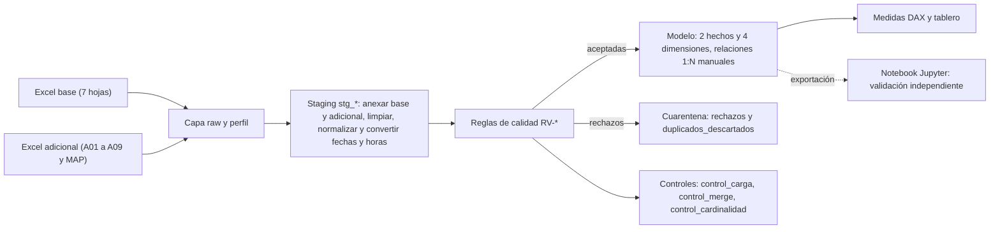
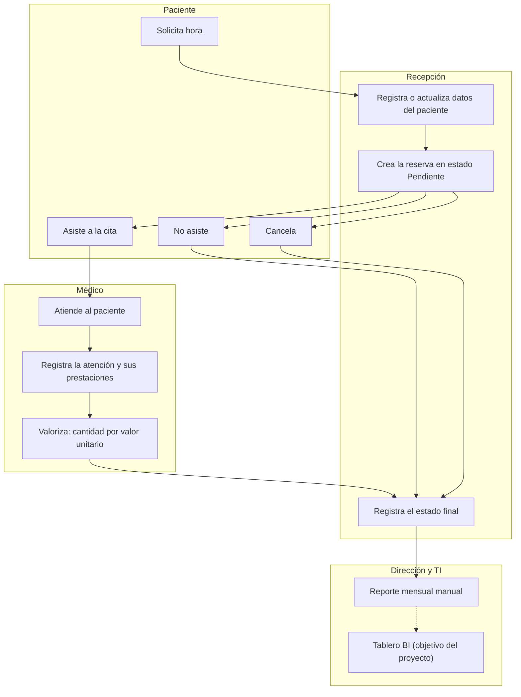
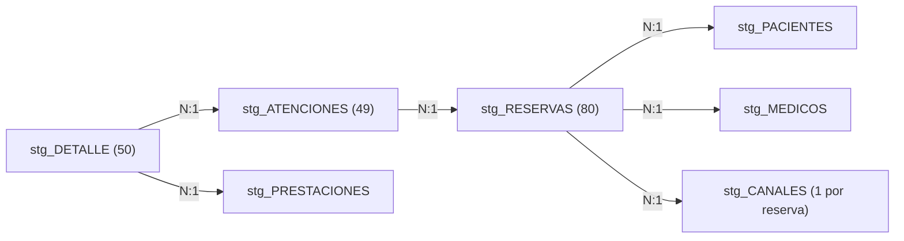
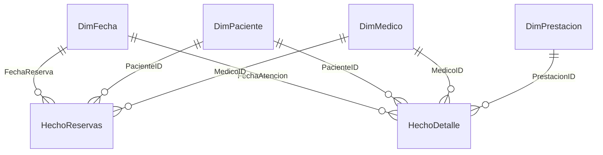
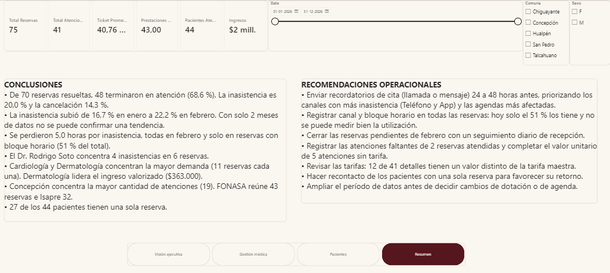

<div align="center">

  

  **Departamento de electronica y informatica**
  **USM sede Concepción**

  &nbsp;

  ## SaludVital
  ### Diseño e implementación de una solución de inteligencia de negocio para un centro médico ambulatorio

  &nbsp;

  **Informe Proyecto Integrador**
  Asignatura: Inteligencia de negocio - BI

  &nbsp;

  | | |
  |---|---|
  | **Integrantes** | Lukas Garrido <br> Octavio Valencia |
  | **Equipo** | Grupo 07 |
  | **Profesor** | Alexandra Matus |
  | **Fecha** | 18 de noviembre de 2026 |
  | **Versión del documento** | v3.0 |
  | **Repositorio** | [SaludVital](https://github.com/LukasGarrido/SaludVital) |

</div>
---

## Resumen

El presente informe documenta el diseño e implementación de una solución de inteligencia de negocio para SaludVital, un centro médico privado de atención ambulatoria de la Región del Biobío. El centro no cuenta con una arquitectura de datos apta para el análisis multidimensional, lo que se traduce en información distribuida, registros inconsistentes y reportes mensuales elaborados de forma manual.

El trabajo integra **dos fuentes de datos**: el libro base `SaludVital_BaseDatos.xlsx` (7 tablas, período del 05-01-2026 al 03-02-2026) y el libro de datos adicionales `SaludVital_DatosAdicionales_ETL.xlsx` (hojas `A01` a `A09` y `MAP_ESPECIALIDADES`, período del 04-02-2026 en adelante), el cual incorpora de forma deliberada errores de calidad para ejercitar el proceso ETL. Ambas fuentes se anexan, depuran y cargan en un modelo dimensional en estrella con dos tablas de hechos (`HechoReservas` y `HechoDetalle`) y cuatro dimensiones, construido en Power BI mediante Power Query y DAX.

El proceso ETL procesó 80 reservas, 49 atenciones y 50 detalles de atención de entrada. Aceptó 75, 46 y 41 registros respectivamente, y envió 34 filas a cuarentena con origen y motivo documentados. La prueba de idempotencia confirmó que cargas repetidas producen los mismos conteos.

Los resultados fueron validados con un notebook de Jupyter y con un recálculo independiente en Python realizado directamente sobre los archivos Excel originales. Los tres procedimientos coinciden en todas las cifras principales: 75 reservas (48 atendidas, 12 inasistencias, 10 cancelaciones y 5 pendientes), tasa de atención de 68,6 %, tasa de inasistencia de 20,0 %, tasa de cancelación de 14,3 % e ingreso valorizado de $1.671.000 CLP. El informe también registra las discrepancias metodológicas detectadas durante la validación y las recomendaciones derivadas.

El modelo se explota en un tablero de Power BI de cuatro páginas (Resumen, Visión ejecutiva, Gestión médica y Pacientes) con filtros por fecha, comuna y sexo y una nota visible de cobertura, simulación y limitaciones. El informe cierra con conclusiones y recomendaciones operacionales, sin recomendaciones clínicas.

**Palabras clave:** inteligencia de negocio, ETL, modelo dimensional, Power BI, DAX, tablero, calidad de datos, centro médico.

---

## Índice

1. [Introducción](#1-introducción)
2. [Objetivos](#2-objetivos)
3. [Análisis del negocio](#3-análisis-del-negocio)
4. [Reglas de negocio](#4-reglas-de-negocio)
5. [Requerimientos de inteligencia de negocio](#5-requerimientos-de-inteligencia-de-negocio)
6. [Fuentes de datos y perfilamiento](#6-fuentes-de-datos-y-perfilamiento)
7. [Proceso ETL en Power BI](#7-proceso-etl-en-power-bi)
8. [Modelo dimensional](#8-modelo-dimensional)
9. [Medidas DAX y tablero](#9-medidas-dax-y-tablero)
10. [Validación de resultados con Jupyter](#10-validación-de-resultados-con-jupyter)
11. [Análisis de resultados](#11-análisis-de-resultados)
12. [Limitaciones del estudio](#12-limitaciones-del-estudio)
13. [Conclusiones y recomendaciones](#13-conclusiones-y-recomendaciones)
14. [Referencias](#14-referencias)

---

## 1. Introducción

### 1.1. Contexto

SaludVital es un centro médico privado que presta servicios de atención ambulatoria a pacientes de la Región del Biobío. Su operación diaria genera datos de reservas, atenciones y prestaciones, pero los sistemas que los almacenan no fueron concebidos para el análisis multidimensional. Como consecuencia, la Dirección recibe informes mensuales preparados manualmente y no dispone de una visión consolidada de la demanda, la utilización de horas, el desempeño de los profesionales ni los ingresos.

### 1.2. Alcance y fuentes de datos

El proyecto abarca el ciclo completo de una solución de inteligencia de negocio, desde el análisis del negocio hasta la validación de resultados. Los datos corresponden a una **simulación** y no a la operación real del centro. Se trabaja con dos libros Excel que se consolidan durante el ETL:

| Fuente | Contenido | Período |
|---|---|---|
| Base de datos original (`SaludVital_BaseDatos.xlsx`) | 7 hojas: `01_PACIENTES`, `02_MEDICOS`, `03_ESPECIALIDADES`, `04_PRESTACIONES`, `05_RESERVAS`, `06_ATENCIONES`, `07_DETALLE_ATENCION` | 05-01-2026 al 03-02-2026 |
| Base de datos adicionales (`SaludVital_DatosAdicionales_ETL.xlsx`) | Hojas `A01` a `A09` (pacientes, médicos, especialidades, prestaciones, reservas, atenciones, detalle, canales y bloques, etiquetas), `MAP_ESPECIALIDADES`, `LEEME`, `ACTIVIDADES12` y `DICCIONARIO` | 04-02-2026 en adelante |

Según el archivo `LEEME`, el período adicional se extiende hasta el 31-03-2026. Sin embargo, tras la depuración las reservas aceptadas llegan solo hasta el 28-02-2026, porque los registros con fecha 31-03-2026 corresponden a filas rechazadas por claves inválidas. Los períodos son una hipótesis de simulación y no un hecho sobre la periodicidad real del centro.

### 1.3. Estructura del informe

Los capítulos 3 a 5 presentan el análisis del negocio, las reglas y los requerimientos. El capítulo 6 perfila ambas fuentes. Los capítulos 7 a 9 documentan el ETL, el modelo dimensional, las medidas DAX y el tablero de Power BI. El capítulo 10 valida los resultados con Jupyter, el capítulo 11 los analiza y los capítulos 12 a 14 cierran con las limitaciones, las conclusiones con sus recomendaciones operacionales y las referencias.

---

## 2. Objetivos

### 2.1. Objetivo general

Diseñar e implementar una solución de inteligencia de negocio que permita analizar las atenciones médicas de SaludVital y apoyar la toma de decisiones de la Dirección.

### 2.2. Objetivos específicos

1. Analizar el negocio, estudiando la trayectoria y el modelo de atención de SaludVital.
2. Identificar actores y procesos, mapeando quiénes interactúan con el centro y qué operaciones realizan.
3. Identificar las entidades de negocio y las preguntas que cada una necesita responder.
4. Definir reglas de negocio que establezcan los límites y políticas que rigen el flujo de datos.
5. Analizar la calidad de los datos de ambas fuentes, diagnosticando inconsistencias, duplicados, nulos y claves inválidas.
6. Identificar los indicadores relevantes de desempeño.
7. Definir los requerimientos de inteligencia de negocio de la Dirección.
8. Determinar la granularidad de los hechos.
9. Diseñar un modelo dimensional en estrella.
10. Implementar el proceso ETL de extracción, transformación, validación y carga hacia el modelo.
11. Construir un Data Mart orientado al área de la salud.
12. Programar las medidas DAX necesarias para el análisis de métricas agregadas.
13. Diseñar un tablero interactivo para monitorear los indicadores principales.
14. Validar los resultados mediante un análisis independiente en Jupyter e interpretar los hallazgos.
15. Proponer recomendaciones basadas en la evidencia obtenida.

---

## 3. Análisis del negocio

### 3.1. Historia

SaludVital lleva 8 años operando como centro de atención médica ambulatoria. Comenzó con un número reducido de servicios (Medicina General, Pediatría, Ginecología y Traumatología) y, debido a la alta demanda, hoy cuenta con 10 especialidades médicas y más de 20 profesionales. Atiende aproximadamente 2.000 consultas mensuales. Las horas se reservan de manera presencial en recepción, por teléfono, mediante el sitio web o a través de la aplicación móvil.

Los datos de la simulación incluyen, además, dos especialidades de reciente incorporación en el período adicional (`E11` Nutrición y `E12` Rehabilitación), por lo que el modelo analítico trabaja con 12 especialidades y 14 médicos activos.

### 3.2. Actores

**Internos**

| Actor | Rol |
|---|---|
| Paciente | Solicita y recibe atención, reserva y cancela horas |
| Médico o profesional de salud | Otorga la atención y registra su detalle |
| Personal de recepción | Gestiona reservas presenciales y telefónicas, y confirma asistencia |
| Dirección y Administración | Toma decisiones estratégicas y evalúa el desempeño |
| Área de Sistemas y TI | Administra los sistemas de información |
| Facturación y Finanzas | Gestiona cobros e ingresos por atenciones |

**Externos**

| Actor | Rol |
|---|---|
| Sitio web de reservas | Canal digital para agendar horas |
| Aplicación móvil | Canal alternativo de reserva y gestión |
| Call center o central telefónica | Canal telefónico de reserva |

### 3.3. Procesos

- Reserva de hora médica por los cuatro canales.
- Registro y actualización de datos del paciente.
- Confirmación de la hora.
- Atención médica y registro de prestaciones.
- Cancelación o reprogramación de la hora.
- Registro del estado final (Atendida, Cancelada, No asistió o Pendiente).
- Facturación de la atención.
- Generación manual de reportes mensuales.
- Gestión de especialidades y profesionales.

### 3.4. Problemas identificados

1. **Información distribuida.** Los datos de pacientes, médicos y atenciones residen en fuentes distintas.
2. **Pacientes duplicados.** Existen personas registradas más de una vez por diferencias de escritura (por ejemplo, «Juan Pérez», «Juan A. Pérez» y «JUAN PEREZ»).
3. **Especialidades inconsistentes.** Una misma especialidad aparece con nombres diferentes (por ejemplo, «Traumatología», «Traumatologia», «TRAUMATOLOGIA» y «Trauma»).
4. **Horas no concretadas.** No todas las reservas terminan en atención efectiva, ya que existen los estados Cancelada, No asistió y Pendiente.
5. **Reportes manuales.** La Dirección recibe informes mensuales elaborados a mano.
6. **Dificultad para evaluar desempeño.** No existe una visión consolidada de demanda por especialidad, utilización de horas, atenciones por médico, cancelaciones, inasistencias e ingresos.

---

## 4. Reglas de negocio

Un catálogo de reglas de negocio es una lista ordenada y documentada de las condiciones, restricciones y políticas bajo las cuales opera una organización. Las reglas que siguen se actualizaron respecto de la versión anterior del informe para reflejar el uso de **dos fuentes** y las decisiones efectivamente implementadas en el ETL.

### 4.1. Reglas de limpieza y estructura de datos

**Tabla 1.** Reglas de limpieza y estructura.

| ID | Regla | Impacto |
|---|---|---|
| RN01 | **Reconstrucción de especialidades.** La hoja `03_ESPECIALIDADES` de la base original es una copia exacta de `02_MEDICOS` y no contiene nombres. El catálogo se reconstruye a partir de los códigos `EspecialidadID` únicos de `04_PRESTACIONES` (E01 a E10). Los nombres de E01 a E10 provienen de `MAP_ESPECIALIDADES` y los de E11 y E12 de `A03_ESPECIALIDADES`, marcados con `Es_nueva_alta = true`. | Atributo `Especialidad` en `DimMedico` y `DimPrestacion` |
| RN02 | **Normalización de etiquetas.** Una etiqueta se resuelve automáticamente solo cuando difiere en espacios, tildes, mayúsculas o cuando un número viene escrito como texto. Se conserva siempre la etiqueta original junto a la canónica y los nulos no se modifican. Las etiquetas sin respaldo de un catálogo (por ejemplo, `WEB` y `Kiosco`) no se interpretan. | Limpieza de especialidades, estados y canales |
| RN03 | **Unificación de pacientes.** Los pacientes se identifican por `PacienteID`. Se elimina el duplicado exacto (`P101`) y la primera ocurrencia prevalece. La detección de duplicados por variantes de escritura de nombre no se observó en los datos y queda como control futuro. | `DimPaciente` |
| RN13 | **Conversión de fechas y horas.** Las fechas y horas se convierten con `fn_fecha` y `fn_hora`, que interpretan números de serie de Excel, fracciones de día, texto `yyyy-MM-dd` o `yyyy/MM/dd` y valores ya tipados. Un valor no interpretable resulta nulo y el valor de origen se conserva en la columna `_raw`. | Campos de fecha y hora de las fuentes |

### 4.2. Reglas operativas y de atención

**Tabla 2.** Reglas operativas.

| ID | Regla | Impacto |
|---|---|---|
| RN04 | **Atenciones efectivas.** Una reserva se considera atención efectiva solo si su estado es estrictamente «Atendida». | Tasa de atención, atenciones realizadas |
| RN05 | **Inasistencias y cancelaciones.** Las reservas «Cancelada», «Pendiente» o «No asistió» no generan prestaciones ni ingresos. | Ingresos, tasa de inasistencia |
| RN06 | **Horas perdidas.** Exclusivamente el estado «No asistió» se contabiliza como hora perdida. Se calcula con los minutos del bloque (`BloqueMinutos`). | Horas perdidas y utilización |
| RN09 | **Reservas resueltas.** Las tasas se calculan sobre reservas resueltas (Atendida, No asistió y Cancelada). Las reservas Pendientes se informan aparte y no entran al denominador. | Medidas de tasas |

### 4.3. Reglas financieras y de modelo dimensional

**Tabla 3.** Reglas financieras y de modelo.

| ID | Regla | Impacto |
|---|---|---|
| RN07 | **Cálculo de ingresos.** El ingreso es la suma de `Cantidad × ValorUnitario` de los detalles de atenciones aceptadas. Es un ingreso **valorizado** y no cobrado, porque no existe fuente de pagos. | Medidas de ingresos |
| RN08 | **Granularidad.** Existen dos hechos con granos distintos. La reserva es una hora agendada y el detalle es una prestación dentro de una atención. | Modelo dimensional |
| RN10 | **Claves y duplicados.** La clave natural es el identificador de negocio. Solo se eliminan duplicados exactos y gana la primera ocurrencia (base antes que adicional). | Idempotencia |
| RN11 | **Integridad y cuarentena.** Toda fila con clave foránea inválida o nula, campo obligatorio vacío, patrón de ID incorrecto, estado fuera de catálogo o tarifa ausente se rechaza con origen y motivo. No se completan datos por intuición. | Bitácora de calidad |
| RN12 | **Cobertura de canal.** El canal y el bloque solo existen desde el 04-02-2026. Las reservas anteriores figuran como «No registrado». | Canales y utilización |

---

## 5. Requerimientos de inteligencia de negocio

**Tabla 4.** Matriz de requerimientos.

| ID | Pregunta | Indicador | Dimensión | Prioridad |
|---|---|---|---|---|
| **Demanda** | | | | |
| RQ01 | ¿Cuántas reservas se realizan mensualmente? | Total de reservas | Tiempo | Alta |
| RQ02 | ¿Cuál es la especialidad más solicitada? | Total de reservas | Especialidad | Alta |
| RQ03 | ¿Qué días de la semana presentan mayor demanda? | Total de reservas | Día de la semana | Media |
| RQ04 | ¿Cómo evoluciona la demanda durante el período? | Total de reservas | Mes | Alta |
| **Atención** | | | | |
| RQ05 | ¿Qué porcentaje de reservas termina en una atención efectiva? | Tasa de atención | Tiempo, especialidad | Alta |
| RQ06 | ¿Cuál es la tasa de inasistencia por especialidad? | Tasa de inasistencia | Especialidad | Alta |
| RQ07 | ¿Cuál es la tasa de cancelación de horas? | Tasa de cancelación | Tiempo | Media |
| RQ08 | ¿Cuántas horas se pierden por inasistencia? | Horas perdidas | Tiempo, médico | Alta |
| **Médicos** | | | | |
| RQ09 | ¿Qué médicos atienden más pacientes? | Atenciones realizadas | Médico | Alta |
| RQ10 | ¿Cuál es el ranking de profesionales por atenciones? | Atenciones realizadas | Médico | Media |
| RQ11 | ¿Cuál es la utilización de horas por médico? | Utilización | Médico, tiempo | Alta |
| RQ12 | ¿Qué especialidad concentra más profesionales y mayor carga? | Atenciones realizadas | Especialidad, médico | Media |
| **Pacientes** | | | | |
| RQ13 | ¿Qué comunas concentran más pacientes atendidos? | Atenciones realizadas | Comuna | Media |
| RQ14 | ¿Qué pacientes usan con mayor frecuencia los servicios? | Frecuencia de atención | Paciente | Media |
| RQ15 | ¿Cómo se distribuye la cartera por previsión? | Total de pacientes | Previsión | Baja |
| RQ16 | ¿Cómo evoluciona la base de pacientes atendidos? | Pacientes distintos | Tiempo | Media |
| **Ingresos** | | | | |
| RQ17 | ¿Cuáles son los ingresos totales por período? | Ingresos | Tiempo | Alta |
| RQ18 | ¿Qué especialidades generan mayores ingresos? | Ingresos | Especialidad | Alta |
| RQ19 | ¿Cuál es el ingreso promedio por atención? | Ingreso promedio por atención | Especialidad, médico | Media |
| RQ20 | ¿Qué prestaciones son las más solicitadas y rentables? | Ingresos, cantidad | Prestación | Media |
| **Especialidades** | | | | |
| RQ21 | ¿Cuántas especialidades activas tiene el centro y cuál es su carga? | Atenciones realizadas | Especialidad | Media |
| RQ22 | ¿Qué especialidad presenta mayor crecimiento de demanda interanual? | Total de reservas | Especialidad, tiempo | Baja |
| RQ23 | ¿Cómo se compara la tasa de atención entre especialidades? | Tasa de atención | Especialidad | Media |
| RQ24 | ¿Qué especialidades requieren más profesionales para cubrir su demanda? | Utilización | Especialidad, médico | Baja |

---

## 6. Fuentes de datos y perfilamiento

### 6.1. Inventario de fuentes

El inventario completo se documentó en el archivo `Inventario_SaludVital_v1.0_2026-11-04.xlsx` (propósito, grano y fecha de cada fuente). La Tabla siguiente resume las fuentes y su rol en el ETL.

**Tabla 5.** Inventario de fuentes y filas de entrada.

| Entidad | Hoja base | Hoja adicional | Filas de entrada (base + adicional) | Observación |
|---|---|---|---|---|
| Pacientes | `01_PACIENTES` (33) | `A01_PACIENTES` (16) | 49 | Columna B vacía en la base |
| Médicos | `02_MEDICOS` (10) | `A02_MEDICOS` (7) | 17 | |
| Especialidades | `03_ESPECIALIDADES` (10) | `A03_ESPECIALIDADES` (3) | 13 | La hoja base copia a `02_MEDICOS` |
| Prestaciones | `04_PRESTACIONES` (15) | `A04_PRESTACIONES` (6) | 21 | |
| Reservas | `05_RESERVAS` (30) | `A05_RESERVAS` (50 sin fila vacía) | 80 | Columna vacía intencional en A05 |
| Atenciones | `06_ATENCIONES` (22) | `A06_ATENCIONES` (27) | 49 | |
| Detalle de atención | `07_DETALLE_ATENCION` (22) | `A07_DETALLE_ATENCION` (28) | 50 | |
| Canales y bloques | No existe | `A08_CANALES_BLOQUES` (52 sin fila vacía) | 52 | Fuente simulada |
| Etiquetas | No existe | `MAP_ESPECIALIDADES` (13), `A09_ETIQUETAS_RAW` (7) | | Apoyo al mapeo |

### 6.2. Perfil raw

El perfil raw se ejecutó el 04-11-2026 sobre la capa de extracción de Power BI, antes de cualquier transformación. Se aplicaron las siguientes definiciones:

- **Nulo o blanco:** celda nula o texto que queda vacío tras `Text.Trim`.
- **Fila vacía:** fila donde todos los campos son nulos o blancos.
- **Duplicado exacto:** fila idéntica a otra en todos los campos (`Table.Distinct`).
- **Clave repetida:** identificador no nulo que aparece más de una vez, aunque el resto de la fila difiera.

**Tabla 6.** Perfil raw de las hojas base profundizadas (extracto).

| Fuente | Campo | Filas físicas | Nulos | Distintos | Long. máx. | Tipos |
|---|---|---|---|---|---|---|
| `01_PACIENTES` | PacienteID | 33 | 0 | 33 | 4 | texto |
| `01_PACIENTES` | Sexo | 33 | 3 | 2 | 1 | texto, nulo |
| `01_PACIENTES` | Prevision | 33 | 3 | 2 | 6 | texto, nulo |
| `01_PACIENTES` | FechaNacimiento | 33 | 3 | 30 | 10 | fecha, nulo |
| `01_PACIENTES` | Nombre | 33 | 3 | 30 | 19 | texto, nulo |
| `01_PACIENTES` | Comuna | 33 | 3 | 5 | 11 | texto, nulo |
| `01_PACIENTES` | Columna B | 33 | 33 | 0 | | nulo |
| `02_MEDICOS` | Columnas 1 a 3 | 11 | 0 | 11 | 8, 20 y 14 | texto |
| `03_ESPECIALIDADES` | Columnas 1 a 3 | 11 | 0 | 11 | 8, 20 y 14 | texto |
| `04_PRESTACIONES` | EspecialidadID | 15 | 0 | 10 | 3 | texto |
| `04_PRESTACIONES` | Valor | 15 | 0 | 14 | 5 | número |
| `04_PRESTACIONES` | Prestacion | 15 | 0 | 15 | 27 | texto |

Las hojas `02_MEDICOS` y `03_ESPECIALIDADES` presentan 11 filas físicas porque la fila de encabezados aún no estaba promovida en la capa raw (10 registros más el encabezado). Sus perfiles son idénticos columna a columna, lo que confirma que la segunda es copia de la primera. No se detectaron duplicados exactos ni claves repetidas en estas hojas base.

### 6.3. Hallazgos de calidad

**Tabla 7.** Hallazgos de calidad en ambas fuentes.

| Hallazgo | Fuente y campo | Evidencia | Regla | Tratamiento |
|---|---|---|---|---|
| Hoja de especialidades corrupta | `03_ESPECIALIDADES` | Idéntica a `02_MEDICOS` | RN01 | Se descarta y se reconstruye el catálogo |
| Columna vacía sin uso | `01_PACIENTES` columna B | 33 de 33 nulos | RN11 | Se excluye en la extracción |
| Pacientes incompletos | `P031`, `P032`, `P033` (base) y `P115` (adicional) | Todos los campos nulos salvo el ID | RN11 | Cuarentena, ninguna reserva los usa |
| Duplicados exactos en dimensiones | `P101`, `M011`, `E11`, `PR016` | Fila repetida de forma idéntica | RN10 | Se conserva la primera ocurrencia |
| Duplicados exactos en hechos | `R0113` (reservas y canales), `A0101` (atenciones) y `DA0101` (detalle) | Fila repetida de forma idéntica, 4 casos en total | RN10 | Se conserva la primera y se registra en `duplicados_descartados` |
| Fecha y hora en formatos mezclados | `A05_RESERVAS`, `A01_PACIENTES` | Números de serie de Excel (por ejemplo `46057`), texto `2026/02/07`, y horas como texto (`09:30`) o fracción del día, junto a formatos estándar | RN13 | Conversión con `fn_fecha` y `fn_hora` conservando el valor raw (sección 7.5) |
| Estados con variantes | `A05_RESERVAS.EstadoReserva` | `ATENDIDA` (5 filas) y `No Asistio` | RN02 | Normalización con catálogo |
| Estado fuera de catálogo | `R0129` | `Confirmada` | RN11 | Cuarentena, no se interpreta |
| ID con patrón inválido | Reservas y canales | `1234` en lugar de `R0139` | RN11 | Cuarentena |
| Claves foráneas inválidas | Médicos, reservas, atenciones, detalle y canales | `E99`, `M099`, `R9999`, `A9999`, `PR9999` y paciente nulo | RN11 | Cuarentena |
| Valores obligatorios nulos | Detalle (5 `ValorUnitario`), prestaciones (`PR020`) | Tarifa ausente | RN11 | Cuarentena |
| Canal sin catálogo | `A08_CANALES_BLOQUES` | `WEB` (8 filas) y `Kiosco` (1 fila) | RN02 | Quedan como «Sin resolver» |
| Bloque nulo | `A08_CANALES_BLOQUES` | 8 filas `telefono` sin `BloqueMinutos` | RN11 | Cuarentena |
| Clave repetida con contenido distinto | `R0113` en A08 | 3 apariciones, una con contenido distinto | RN10 | Se conserva la primera y se registra el conflicto |
| Estado Pendiente ausente en la base | `05_RESERVAS` | Solo 3 de 4 estados | RN09 | Aparece en la fuente adicional (5 reservas) |

### 6.4. Integridad referencial de la base original

| Relación verificada | Resultado |
|---|---|
| `RESERVAS.PacienteID` hacia `PACIENTES` | Sin huérfanos |
| `RESERVAS.MedicoID` hacia `MEDICOS` | Sin huérfanos |
| `ATENCIONES.ReservaID` hacia `RESERVAS` | Sin huérfanos, relación 1 a 1 |
| Reservas «Atendida» frente a atenciones | 22 contra 22 en la base original |
| `DETALLE_ATENCION.AtencionID` hacia `ATENCIONES` | Sin huérfanos |
| `DETALLE_ATENCION.PrestacionID` hacia `PRESTACIONES` | Sin huérfanos |
| `ValorUnitario` frente a la tarifa maestra | Coincide en 22 de 22 casos |

**Conclusión del perfilamiento.** La base original tiene tablas transaccionales limpias y sus problemas se concentran en las tablas maestras. La base adicional, en cambio, introduce deliberadamente errores en todas las entidades. Al consolidar ambas fuentes cambian dos conclusiones de la versión anterior del informe. En primer lugar, el estado «Pendiente» sí está representado (5 reservas). En segundo lugar, la coincidencia entre tarifa de detalle y tarifa maestra ya no es total: 12 de los 41 detalles aceptados tienen un `ValorUnitario` distinto de la tarifa maestra. Dado que los 22 detalles de la base coinciden, estas diferencias se concentran en el período adicional.

---

## 7. Proceso ETL en Power BI

### 7.1. Arquitectura y flujo de procesamiento

El proceso ETL se construyó en Power BI con Power Query (lenguaje M) y se organiza en capas. Cada fila de entrada termina en exactamente una de tres salidas: aceptada, duplicado exacto descartado o rechazo con origen y motivo.



### 7.2. Comprensión del proceso y preguntas por entidad

El proceso operativo que alimenta los datos es el siguiente:

1. **Solicitud.** El paciente pide una hora por Recepción, Teléfono, Sitio web o Aplicación móvil.
2. **Registro.** Recepción registra o actualiza los datos del paciente.
3. **Reserva.** Se crea la reserva con paciente, médico, fecha, hora, canal y bloque. Se asume que nace en estado Pendiente.
4. **Resolución.** La reserva termina en Atendida, No asistió o Cancelada.
5. **Atención.** Solo las reservas Atendidas generan una atención registrada por el médico.
6. **Prestación.** Cada atención registra una o más prestaciones con cantidad y valor unitario.
7. **Reporte.** Dirección y TI consumen estos datos.



**Granos de cada registro:** una reserva es una hora reservada, una atención es una atención efectiva, un detalle es una prestación dentro de una atención y una fila de canal y bloque corresponde a una reserva.

**Tabla 8.** Preguntas de negocio trazables a las fuentes.

| ID | Entidad | Pregunta | Fuente y campos |
|---|---|---|---|
| D1 | Dirección | ¿Cuántas reservas y atenciones hay por mes? | `FechaReserva`, `FechaAtencion` |
| D2 | Dirección | ¿Qué ingreso valorizado generan las atenciones por mes? | Detalle (`Cantidad` por `ValorUnitario`) |
| D3 | Dirección | ¿Qué especialidades generan más ingreso? | Prestaciones y detalle |
| D4 | Dirección | ¿Cuál es la tasa de inasistencia mensual? | `EstadoReserva` |
| D5 | Dirección | ¿Cuánto cambia la demanda entre el período base y el adicional? | `FechaReserva` |
| R1 | Recepción | ¿Qué canal concentra más reservas? | `CanalReserva` |
| R2 | Recepción | ¿Qué canal tiene más inasistencias? | `CanalReserva`, `EstadoReserva` |
| R3 | Recepción | ¿En qué día y hora hay más demanda? | `FechaReserva`, `HoraReserva` |
| R4 | Recepción | ¿Cuántas reservas quedan Pendientes o Canceladas? | `EstadoReserva` |
| R5 | Recepción | ¿Cuántas horas se pierden por inasistencia? | `BloqueMinutos`, estado No asistió |
| M1 | Profesionales | ¿Cuántas atenciones realiza cada médico? | Atenciones y reservas |
| M2 | Profesionales | ¿Qué tasa de atención tiene cada médico? | `MedicoID`, `EstadoReserva` |
| M3 | Profesionales | ¿Qué prestaciones realiza más cada médico? | `PrestacionID` |
| M4 | Profesionales | ¿Cuál es el ingreso promedio por atención de cada médico? | Detalle y atenciones |
| M5 | Profesionales | ¿Qué médico tiene más inasistencias en su agenda? | `MedicoID`, `EstadoReserva` |
| P1 | Pacientes | ¿Cuántos pacientes distintos se atienden por mes? | `PacienteID` (conteo distinto) |
| P2 | Pacientes | ¿Con qué frecuencia vuelve cada paciente? | `PacienteID` por reserva |
| P3 | Pacientes | ¿Qué comunas concentran más pacientes? | `Comuna` |
| P4 | Pacientes | ¿Cómo se distribuyen las reservas por previsión? | `Prevision` |
| P5 | Pacientes | ¿Qué pacientes acumulan inasistencias? (solo IDs) | `PacienteID`, `EstadoReserva` |
| B1 | Equipo BI | ¿Cuántas filas se leen, aceptan y rechazan por fuente? | Todas |
| B2 | Equipo BI | ¿Qué reglas generan más rechazos? | Bitácora de calidad |
| B3 | Equipo BI | ¿Qué etiquetas de especialidad no se resuelven con el catálogo? | `MAP_ESPECIALIDADES` |
| B4 | Equipo BI | ¿El conteo se mantiene al ejecutar el ETL dos veces? | Tablas cargadas |
| B5 | Equipo BI | ¿Existen claves huérfanas entre reservas, atenciones y detalle? | `ReservaID`, `AtencionID`, `PrestacionID` |

**Restricciones de uso.** No se usa la edad como atributo clínico. No se publican nombres en capturas y se emplean IDs. No existen datos clínicos reales, ya que los motivos de atención son categorías operacionales. Los resultados provienen de una simulación.

### 7.3. Contratos y catálogo de reglas de validación

Las reglas de calidad se aprobaron como contratos de datos y se documentaron en `Catalogo_Reglas_SaludVital_v1.0_2026-11-04`. Cada incumplimiento se registra en la bitácora de calidad con los campos `Fuente`, `Clave`, `Campo`, `Regla`, `ValorRaw` y `Motivo`.

**Tabla 9.** Reglas de validación y rechazos generados.

| Regla | Descripción | Rechazos | Casos |
|---|---|---|---|
| RV-FK | Clave foránea inexistente o nula | 11 | `M015` (E99), `R0109`, `R0119` (M099), `A1999`, `A2000`, `DA0125`, `DA1998`, `DA1999` y 3 filas de canales |
| RV-BLOQUE | `BloqueMinutos` nulo o no numérico | 8 | Filas de canal `telefono` sin bloque |
| RV-VALOR | Valor unitario nulo en el detalle | 5 | `DA0104`, `DA0109`, `DA0114`, `DA0119`, `DA0124` |
| RV-OBLIGATORIO | Campo obligatorio nulo | 5 | `P031`, `P032`, `P033`, `P115`, `M016` |
| RV-ID-PATRON | El ID no cumple el patrón `^R\d{4}$` | 2 | `1234` en reservas y en canales |
| RV-TARIFA | Tarifa ausente en una prestación | 1 | `PR020` |
| RV-ESTADO | Estado fuera del catálogo acordado | 1 | `R0129` (Confirmada) |
| RV-CLAVE-REPETIDA | Clave repetida con contenido distinto | 1 | `R0113` en canales |
| **Total** | | **34** | |

### 7.4. Mapeo de etiquetas

Se aplicó el criterio de equivalencia evidente descrito en RN02. Los nombres canónicos de E01 a E10 son una propuesta basada en `MAP_ESPECIALIDADES` y en las prestaciones, pendiente de aprobación formal.

**Tabla 10.** Resultado del mapeo de etiquetas.

| Entidad | Filas de mapeo | Resultado |
|---|---|---|
| Especialidad | 13 | 11 resueltas y 2 no resueltas (una fila sin ID y `E99`) |
| Estado | 8 | `Confirmada` no resuelta. `Cancelada ` con espacio final (2 filas) y `ATENDIDA` (5 filas) se resuelven |
| Canal | 7 | `WEB ` (8 filas) y `Kiosco` (1 fila) no resueltas. `telefono` se resuelve a Teléfono |

Hay 5 casos no resueltos: la fila de mapeo sin ID, `E99`, `Confirmada`, `WEB` y `Kiosco`. Las decisiones adoptadas fueron las siguientes:

- `TRAUMA` se resuelve por un alias respaldado en `MAP_ESPECIALIDADES`.
- `Confirmada` no se interpreta y permanece en cuarentena.
- `WEB` queda sin resolver porque ningún catálogo la respalda. Se mantuvo el escenario base de no reinterpretar la etiqueta y las reservas afectadas se muestran como «Sin resolver».

### 7.5. Anexión de dimensiones

Cada dimensión une su hoja base con la adicional y agrega la columna `Origen`. Solo se eliminan duplicados exactos y queda la primera ocurrencia. En staging se recortan espacios, el texto vacío pasa a nulo y los números escritos como texto se convierten a número conservando el valor original (`Valor_raw`, `FechaNacimiento_raw`).

**Tabla 11.** Resultado de la anexión de dimensiones.

| Dimensión | Filas antes | Filas después | Descartadas | Duplicado exacto descartado |
|---|---|---|---|---|
| Pacientes | 49 | 48 | 1 | `P101` |
| Médicos | 17 | 16 | 1 | `M011` |
| Especialidades | 13 | 12 | 1 | `E11` |
| Prestaciones | 21 | 20 | 1 | `PR016` |

La verificación `Clave_unica_OK` resultó verdadera en las cuatro dimensiones.

**Conversión de fechas y horas.** Las hojas adicionales entregan fechas y horas con tipos mezclados. Se observaron fechas como número de serie de Excel (por ejemplo `46057`, equivalente al 04-02-2026), como texto con barras (`2026/02/07`) y como fecha ya tipada. Las horas llegan como texto (`09:30`) o como fracción del día (`0,4167` equivale a las 10:00). Dos funciones centralizan la conversión en staging: `fn_fecha` devuelve un valor de tipo fecha y `fn_hora` uno de tipo hora. Ambas devuelven nulo cuando el valor no es interpretable, y el valor de origen se conserva en las columnas `_raw`.

**Tabla 12.** Reglas de conversión de `fn_fecha` y `fn_hora`.

| Función | Entrada | Tratamiento |
|---|---|---|
| `fn_fecha` | Nulo | Nulo |
| `fn_fecha` | Número | Fecha = 30-12-1899 más la parte entera (serie de Excel) |
| `fn_fecha` | Fecha o fecha y hora | Se conserva la fecha |
| `fn_fecha` | Texto que representa un número entre 30.000 y 80.000 | Igual que un número, leído con cultura `es-CL` |
| `fn_fecha` | Texto `yyyy-MM-dd` o `yyyy/MM/dd` | Se reemplaza `/` por `-` y se convierte |
| `fn_fecha` | Cualquier otro valor | Nulo |
| `fn_hora` | Nulo | Nulo |
| `fn_hora` | Número | Fracción del día multiplicada por 86.400 segundos |
| `fn_hora` | Hora o fecha y hora | Se conserva la hora, redondeada al segundo |
| `fn_hora` | Texto que representa un número entre 0 y 1 | Igual que un número, leído con cultura `es-CL` |
| `fn_hora` | Texto de hora (`09:30`) | `Time.FromText` con cultura `en-US` |
| `fn_hora` | Cualquier otro valor | Nulo |

El rango de 30.000 a 80.000 en `fn_fecha` (aproximadamente los años 1982 a 2118) evita interpretar como fecha un número cualquiera.

```powerquery
// fn_fecha
(v as any) as nullable date =>
  if v = null then null
  else if v is number then Date.From(#date(1899, 12, 30) + #duration(Number.RoundDown(v), 0, 0, 0))
  else if v is date then v
  else if v is datetime then DateTime.Date(v)
  else if v is text then (
    let
      t = Text.Trim(v),
      n = try Number.FromText(t, "es-CL") otherwise null
    in
      if n <> null and n > 30000 and n < 80000
      then Date.From(#date(1899, 12, 30) + #duration(Number.RoundDown(n), 0, 0, 0))
      else try Date.FromText(Text.Replace(t, "/", "-"), [Format = "yyyy-MM-dd", Culture = "en-US"]) otherwise null
  )
  else null
```

```powerquery
// fn_hora
(v as any) as nullable time =>
  let
    aTime = (s as number) as time => #time(0, 0, 0) + #duration(0, 0, 0, Number.Mod(Number.Round(s, 0), 86400)),
    segs = (x as time) as number => Duration.TotalSeconds(x - #time(0, 0, 0))
  in
    if v = null then null
    else if v is number then aTime(v * 86400)
    else if v is time then aTime(segs(v))
    else if v is datetime then aTime(segs(DateTime.Time(v)))
    else if v is text then (
      let
        t = Text.Trim(v),
        n = try Number.FromText(t, "es-CL") otherwise null
      in
        if n <> null and n >= 0 and n < 1 then aTime(n * 86400)
        else try aTime(segs(Time.FromText(t, "en-US"))) otherwise null
    )
    else null
```

Las versiones iniciales de ambas funciones no tenían la rama numérica, por lo que toda fecha u hora entregada como número se convertía en nulo. El efecto se detectó en `control_carga`:

**Tabla 13.** Filas aceptadas antes y después de corregir las funciones de conversión.

| Tabla | Aceptadas con las funciones iniciales | Aceptadas con las funciones actuales |
|---|---|---|
| Reservas | 33 | 75 |
| Atenciones | 24 | 46 |
| Detalle | 23 | 41 |
| Canales y bloques | 2 | 38 |

Los conteos de pacientes (44), médicos (14) y prestaciones (19) no cambiaron. Para validar las funciones se usó una consulta temporal de diagnóstico (`diag_fecha`), en la que `R0101` debe resultar en 04-02-2026 a las 10:00:00, `R0102` en 04-02-2026 a las 11:00:00, `R0103` en 05-02-2026 a las 9:30:00 y `R0107` en 07-02-2026, sin nulos en la columna de fecha.

### 7.6. Combinación sin multiplicación de filas

Los hechos se anexan y se enriquecen con las dimensiones mediante la función `fn_unir`, que falla con error si la clave del lado derecho se repite. De esta manera ninguna combinación duplica filas sin aviso. Cada fila lleva `Fila_id`, `Origen`, `Idx` y `Fuente_orden` para ordenar de forma estable.



`HechoDetalle` se construye a partir de los detalles aceptados. Con `fn_unir` incorpora desde las atenciones aceptadas la reserva (`ReservaID`) y la fecha de atención (`FechaAtencion`), y desde las reservas aceptadas el paciente (`PacienteID`) y el médico (`MedicoID`). El importe se calcula como `Cantidad × ValorUnitario`. Por esta razón las dimensiones de paciente y médico se relacionan con ambos hechos (sección 7.10).

**Tabla 14.** Control de combinaciones (`control_merge`).

| Combinación | Antes | Después | Sin multiplicación |
|---|---|---|---|
| Reservas con pacientes, médicos y canal o bloque (N:1) | 80 | 80 | Verdadero |
| Atenciones con reservas (N:1) | 49 | 49 | Verdadero |
| Detalle con prestaciones (N:1) | 50 | 50 | Verdadero |

**Tabla 15.** Control de cardinalidad (`control_cardinalidad`).

| Lado | Tabla | Filas y claves distintas | Clave única |
|---|---|---|---|
| Dimensión | Pacientes | 48 y 48 | Verdadero |
| Dimensión | Médicos | 16 y 16 | Verdadero |
| Dimensión | Prestaciones | 20 y 20 | Verdadero |
| Hecho | Reservas | 80 y 79 | Falso |
| Hecho | Atenciones | 49 y 48 | Falso |
| Hecho | Detalle | 50 y 49 | Falso |
| Hecho | Canales | 52 y 50 | Falso |

Que los hechos arrojen «Falso» es el resultado esperado, porque contienen duplicados (`R0113`, `A0101` y `DA0101`) y `R0113` aparece tres veces en la fuente de canales, una de ellas con contenido distinto. Esto se resuelve en la etapa de cuarentena. Como contraprueba de multiplicidad, al reemplazar la fuente de canales sin depurar en la consulta de reservas, `fn_unir` falla con el mensaje «La clave derecha no es única», lo que confirma que el candado funciona.

### 7.7. Cuarentena e idempotencia

La clave natural es el identificador de negocio y gana la primera ocurrencia de forma determinista, lo que sostiene la idempotencia del proceso.

La separación entre filas válidas y rechazadas se hace en dos consultas: `dims_ok` para las dimensiones (con las salidas `Ok` y `Rechazo`) y `particion` para los hechos (con las salidas `Aceptados` y `Rechazos`). El modelo lee solo las salidas aceptadas. La tabla `rechazos` combina las 7 salidas de rechazo (pacientes, médicos, prestaciones, reservas, atenciones, detalle y canales y bloques) con las columnas `Fuente`, `Clave`, `Origen`, `Fila_id` y `Motivo`. `Clave` toma el valor «(sin clave)» cuando el identificador es nulo y `Fila_id` toma «(dimensión)» en las filas de dimensiones.

**Tabla 16.** Control de carga (`control_carga`).

| Tabla | Entrada | Aceptadas | Duplicados | Rechazadas |
|---|---|---|---|---|
| Pacientes | 48 | 44 | 0 | 4 |
| Médicos | 16 | 14 | 0 | 2 |
| Prestaciones | 20 | 19 | 0 | 1 |
| Reservas | 80 | 75 | 1 | 4 |
| Atenciones | 49 | 46 | 1 | 2 |
| Detalle | 50 | 41 | 1 | 8 |
| Canales y bloques | 52 | 38 | 1 | 13 |

La columna `Cuadra` (entrada igual a aceptadas más duplicados más rechazadas) y `Claves_unicas_en_aceptadas` son verdaderas en las 7 filas. Los duplicados exactos de las dimensiones se eliminan antes de esta validación (sección 7.5), por lo que figuran en 0. La tabla `rechazos` contiene 34 filas y `duplicados_descartados` contiene 4. Estas cifras corresponden a la ejecución con las funciones de conversión definitivas (sección 7.5).

**Prueba de idempotencia.** Al simular la carga de los mismos datos dos veces (`particion_x2`), las filas aceptadas no cambian: Reservas 75, Atenciones 46, Detalle 41 y Canales y bloques 38. Los indicadores `Mismo_conteo` y `Mismas_filas` resultaron verdaderos. Además, dos refrescos consecutivos en Power BI entregaron los mismos conteos en `control_carga`.

**Decisiones pendientes de aprobación (documento DECISIONES v1.1):**

1. Los 4 pacientes incompletos (`P031`, `P032`, `P033` y `P115`) permanecen en cuarentena. Ninguna reserva los utiliza.
2. Las 8 filas de canal `telefono` con bloque nulo se rechazan según el contrato aprobado, por lo que esas reservas pierden su canal. La alternativa es aceptar el canal y excluir esas filas solo del cálculo de utilización.
3. Quedan 2 reservas Atendida sin atención registrada (`R0146` y `R0148`), hallazgo que se trata en la sección siguiente.

### 7.8. Conciliación posterior a la carga

La conciliación contrasta los conteos del modelo con las reglas de negocio. Se obtuvieron los siguientes resultados:

| Control | Resultado |
|---|---|
| Reservas Atendida frente a atenciones registradas | 48 frente a 46. Faltan las atenciones de `R0146` y `R0148` |
| Atenciones con detalle valorizado | 41 de 46. Las 5 restantes (`A0104`, `A0109`, `A0114`, `A0119` y `A0124`) tienen detalle sin valor unitario y fueron rechazadas por RV-VALOR |
| Integridad referencial del modelo | 7 relaciones verificadas, 0 huérfanos |
| Importe frente a `Cantidad × ValorUnitario` | Diferencia igual a 0 |
| Detalles con tarifa distinta de la maestra | 12 de 41 |

Las atenciones sin detalle valorizado implican que el ingreso total está **subvaluado** respecto del ingreso potencial de las 46 atenciones. Este hecho se considera en la interpretación de resultados.

### 7.9. Herramientas y ejecución

| Componente | Uso |
|---|---|
| Excel | Fuentes de datos (base y adicional) y archivos de evidencia (`Mapeo_etiquetas`, `No_resueltos`) |
| Power BI (Power Query en lenguaje M) | Extracción, staging, reglas de calidad, cuarentena, modelo y tablero de cuatro páginas (capítulo 9) |
| DAX | Medidas, columnas calculadas y la tabla `DimFecha` |
| Python (pandas y matplotlib) en Jupyter | Validación independiente y análisis exploratorio |

La ejecución consiste en confirmar que la detección automática de relaciones esté desactivada (sección 7.10), actualizar el modelo en Power BI, revisar las tablas de control (`control_carga`, `control_merge`, `control_cardinalidad`, `rechazos` y `prueba_idempotencia`) y, para la validación, ejecutar el script de generación del modelo en Python y luego el notebook completo.

### 7.10. Carga al modelo y relaciones

Una vez aceptadas las filas, el modelo se carga con Cerrar y aplicar y las relaciones se definen de forma manual. La detección automática de relaciones de Power BI se desactiva (Archivo, Opciones, Carga de datos, tanto en el nivel global como en el archivo actual). Esa opción propone relaciones por coincidencia de nombres y valores, incluso entre tablas de control y de cuarentena (por ejemplo `mapeo_etiquetas` con `no_resueltos`, o `rechazos` con `duplicados_descartados`), y las propone de 1 a 1 cuando los datos cargados todavía no repiten claves.

`DimFecha` se genera como tabla calculada en DAX (`CALENDAR`) que cubre el año 2026 (del 01-01-2026 al 31-12-2026), con las columnas `Fecha`, `Año`, `MesNum`, `Mes`, `AñoMes` y `DiaSemana`, y se marca como tabla de fechas. No es una consulta de Power Query, por lo que no se traslada al copiar consultas entre archivos y debe recrearse.

**Tabla 17.** Relaciones del modelo. Todas son de uno a varios, con filtro en un solo sentido y estado activo.

| Lado uno (dimensión) | Lado varios (hecho) |
|---|---|
| `DimFecha[Fecha]` | `HechoReservas[FechaReserva]` |
| `DimFecha[Fecha]` | `HechoDetalle[FechaAtencion]` |
| `DimPaciente[PacienteID]` | `HechoReservas[PacienteID]` |
| `DimPaciente[PacienteID]` | `HechoDetalle[PacienteID]` |
| `DimMedico[MedicoID]` | `HechoReservas[MedicoID]` |
| `DimMedico[MedicoID]` | `HechoDetalle[MedicoID]` |
| `DimPrestacion[PrestacionID]` | `HechoDetalle[PrestacionID]` |

Criterios de creación:

- El lado uno es siempre la dimensión, cuya clave única se verificó en `control_cardinalidad` (Tabla 15). Un hecho nunca es el lado uno, porque sus claves de negocio de pacientes, médicos y prestaciones se repiten.
- Las dos columnas relacionadas deben tener el mismo tipo (fecha con fecha, texto con texto).
- Si Power BI propone «Varios a varios» o «Uno a uno», la relación no se guarda, porque indica claves repetidas o tipos distintos.
- Los dos hechos no se relacionan entre sí.

Cada relación se comprobó con una tabla de prueba que cruza un atributo de la dimensión con una medida de conteo. El resultado correcto son valores distintos por fila que suman el total de reservas (75). Un mismo valor repetido en todas las filas indica que la relación no filtra.

### 7.11. Incidencias de implementación y lecciones aprendidas

**Tabla 18.** Incidencias detectadas durante la carga y su resolución.

| Síntoma | Causa | Resolución |
|---|---|---|
| `control_carga` mostraba 33 reservas, 24 atenciones, 23 detalles y 2 canales | `fn_fecha` y `fn_hora` sin rama numérica: las fechas y horas entregadas como número quedaban en nulo | Reemplazo de ambas funciones (sección 7.5) y validación con `diag_fecha` |
| Casi todas las tablas fallaban con «La carga se canceló debido a un error al cargar una tabla anterior» | Era un efecto en cadena de un único error real: `PacienteID` duplicado (`P001`) en `HechoReservas` | Ver la fila siguiente |
| `PacienteID` duplicado en `HechoReservas` al cargar | Con solo 33 reservas cargadas, cada paciente aparecía una vez y Power BI creó relaciones 1 a 1 automáticas. Al corregir las fechas se cargaron 75 reservas con pacientes repetidos y esas relaciones dejaron de ser válidas | Se eliminaron las relaciones, se desactivó la detección automática y las consultas de Power Query se trasladaron a un archivo nuevo, porque el modelo guardado conservaba las relaciones anteriores. Las relaciones se crearon después de forma manual (sección 7.10) |
| Error OLE DB `0x80040E4E` en `rechazos` y `HechoDetalle` | Error genérico del proveedor que apareció junto con el error de relaciones | Dejó de aparecer al reconstruir el modelo sin relaciones automáticas. No se aisló una causa adicional en las consultas |
| Sin `DimFecha` en el archivo nuevo | La tabla no se trasladó al copiar las consultas | Se recreó con DAX, se marcó como tabla de fechas y se relacionó con ambos hechos |

Lecciones derivadas:

1. Corregir primero los datos y verificar `control_carga` antes de definir relaciones, porque las relaciones que Power BI infiere con volúmenes parciales dejan de ser válidas al completarse la carga.
2. Desactivar la detección automática de relaciones antes del primer refresco.
3. Ante una cascada de errores «La carga se canceló…», buscar el primer error de la lista que no tenga ese texto, porque es el único real.
4. Verificar cardinalidad y dirección de filtro antes de guardar cada relación, y confirmar que se seleccionó la misma columna de clave en ambos lados (un error frecuente es elegir `Origen`, que existe en casi todas las tablas).
5. Tras cualquier cambio en `fn_fecha` o `fn_hora`, comprobar que `control_carga` entregue 75, 46, 41 y 38 aceptadas.

---

## 8. Modelo dimensional

### 8.1. Diseño

Se adoptó un esquema en estrella con una constelación de dos tablas de hechos que comparten dimensiones.

**Tabla 19.** Tablas del modelo y su grano.

| Tabla | Tipo | Grano | Clave |
|---|---|---|---|
| `HechoReservas` | Hecho | Una fila por reserva aceptada, con su atención, canal y bloque cuando existen | `ReservaID` (degenerada) |
| `HechoDetalle` | Hecho | Una fila por prestación dentro de una atención aceptada | `DetalleID` (degenerada) |
| `DimFecha` | Dimensión | Un día, del 01-01-2026 al 31-12-2026 | `Fecha` (natural) |
| `DimPaciente` | Dimensión | Un paciente aceptado | `PacienteID` (natural) |
| `DimMedico` | Dimensión | Un médico aceptado, con su especialidad | `MedicoID` (natural) |
| `DimPrestacion` | Dimensión | Una prestación aceptada, con su especialidad | `PrestacionID` (natural) |



### 8.2. Justificación de las decisiones de diseño

- **Dos hechos**, porque los granos son distintos. Mezclar reservas y prestaciones inflaría ingresos y utilización.
- **Sin dimensión de especialidad.** Son 12 filas con un único atributo, por lo que se incorpora como atributo en `DimMedico` y `DimPrestacion`.
- **Sin dimensiones de estado ni canal.** Cada una tiene 4 valores sin atributos propios y se mantienen como columnas del hecho.
- **Campos degenerados:** `ReservaID`, `AtencionID`, `DetalleID` y `EstadoReserva_raw`.
- **Claves naturales.** Los IDs son estables y, si un nombre cambia, se actualiza el atributo.
- **Privacidad.** `DimPaciente` no incluye nombre ni fecha de nacimiento.
- Los dos hechos no se relacionan entre sí y se cruzan a través de las dimensiones. Todas las relaciones son 1 a N, de dimensión a hecho, con filtro en un solo sentido.

Esta versión reemplaza el diseño preliminar del informe anterior (`FACT_RESERVAS`, `FACT_PRESTACIONES`, `DIM_ESPECIALIDAD`, `DIM_ESTADO_RESERVA` y `DIM_TIEMPO`), que se simplificó durante la implementación.

### 8.3. Verificación del modelo cargado

| Tabla | Filas |
|---|---|
| `DimPaciente` | 44 |
| `DimMedico` | 14 |
| `DimPrestacion` | 19 |
| `HechoReservas` | 75 |
| `HechoDetalle` | 41 |

Estados en `HechoReservas`: Atendida 48, No asistió 12, Cancelada 10 y Pendiente 5. La suma de `Importe` es de $1.671.000 CLP (valorizado y no cobrado).

### 8.4. Diccionario semántico

**Tabla 20.** Diccionario de datos del modelo.

| Tabla | Campo | Significado | Tipo |
|---|---|---|---|
| `HechoReservas` | `ReservaID` | Identificador de la reserva | Degenerado |
| `HechoReservas` | `FechaReserva` y `HoraReserva` | Fecha y hora local de Chile, sin zona horaria | Fecha y hora |
| `HechoReservas` | `EstadoReserva` | Atendida, No asistió, Cancelada o Pendiente (normalizado) | Atributo |
| `HechoReservas` | `EstadoReserva_raw` | Valor de origen, para trazabilidad | Degenerado |
| `HechoReservas` | `AtencionID` | Atención asociada, vacío si no hay atención registrada | Degenerado |
| `HechoReservas` | `Canal` | Canal canónico, «Sin resolver» o «No registrado» | Atributo |
| `HechoReservas` | `BloqueMinutos` | Minutos programados de la reserva | Medida base |
| `HechoDetalle` | `DetalleID`, `AtencionID`, `ReservaID` | Claves de negocio | Degenerados |
| `HechoDetalle` | `FechaAtencion` | Fecha de la atención | Fecha |
| `HechoDetalle` | `Cantidad` | Unidades de la prestación | Medida base |
| `HechoDetalle` | `ValorUnitario` | Valor en CLP por unidad | Medida base |
| `HechoDetalle` | `Importe` | `Cantidad × ValorUnitario` en CLP, valorizado y no cobrado | Calculado |
| `DimPrestacion` | `Tarifa_maestra` | Tarifa de referencia, no se suma como ingreso | Atributo |
| `DimMedico` y `DimPrestacion` | `Especialidad` | Nombre canónico de la especialidad | Atributo |
| `DimPaciente` | `Comuna`, `Prevision`, `Sexo` | Atributos de segmentación, sin nombre ni edad | Atributo |
| Todas | `Origen` | Hoja de procedencia (Base o Adicional) | Trazabilidad |

**Limitación del modelo.** El canal solo existe desde el 04-02-2026. Las 30 reservas del período base figuran como «No registrado» y la utilización solo es calculable para las reservas con bloque.

---

## 9. Medidas DAX y tablero

### 9.1. Medidas de negocio

Las definiciones siguientes se implementaron en Power BI y son idénticas a las utilizadas en el notebook de validación.

```dax
Total Reservas = COUNTROWS ( HechoReservas )

Reservas Atendidas =
CALCULATE ( COUNTROWS ( HechoReservas ), HechoReservas[EstadoReserva] = "Atendida" )

Reservas No Asistió =
CALCULATE ( COUNTROWS ( HechoReservas ), HechoReservas[EstadoReserva] = "No asistió" )

Reservas Canceladas =
CALCULATE ( COUNTROWS ( HechoReservas ), HechoReservas[EstadoReserva] = "Cancelada" )

Reservas Pendientes =
CALCULATE ( COUNTROWS ( HechoReservas ), HechoReservas[EstadoReserva] = "Pendiente" )

Reservas Resueltas =
[Reservas Atendidas] + [Reservas No Asistió] + [Reservas Canceladas]

Atenciones Realizadas = DISTINCTCOUNTNOBLANK ( HechoReservas[AtencionID] )

Tasa de Atención = DIVIDE ( [Reservas Atendidas], [Reservas Resueltas] )

Tasa de Inasistencia =
DIVIDE ( [Reservas No Asistió], [Reservas Atendidas] + [Reservas No Asistió] )

Tasa de Cancelación = DIVIDE ( [Reservas Canceladas], [Reservas Resueltas] )

Tasa de Atención sobre Total = DIVIDE ( [Reservas Atendidas], [Total Reservas] )

Ingresos = SUM ( HechoDetalle[Importe] )

Ingreso Promedio por Atención =
DIVIDE ( [Ingresos], DISTINCTCOUNT ( HechoDetalle[AtencionID] ) )

Minutos Programados (con bloque) = SUM ( HechoReservas[BloqueMinutos] )

Minutos Atendidos (con bloque) =
CALCULATE ( SUM ( HechoReservas[BloqueMinutos] ), HechoReservas[EstadoReserva] = "Atendida" )

Horas Perdidas por Inasistencia (con bloque) =
DIVIDE (
    CALCULATE ( SUM ( HechoReservas[BloqueMinutos] ), HechoReservas[EstadoReserva] = "No asistió" ),
    60
)

Utilización (solo reservas con bloque) =
DIVIDE ( [Minutos Atendidos (con bloque)], [Minutos Programados (con bloque)] )

Reservas con Bloque =
CALCULATE (
    COUNTROWS ( HechoReservas ),
    FILTER ( HechoReservas, NOT ISBLANK ( HechoReservas[BloqueMinutos] ) )
)

Cobertura de Bloque = DIVIDE ( [Reservas con Bloque], [Total Reservas] )

Ingresos Recalculados =
SUMX ( HechoDetalle, HechoDetalle[Cantidad] * HechoDetalle[ValorUnitario] )

Diferencia Ingresos = [Ingresos] - [Ingresos Recalculados]
```

### 9.2. Medidas y columnas para el tablero

```dax
Pacientes Distintos = DISTINCTCOUNT ( HechoReservas[PacienteID] )

Reservas por Paciente = DIVIDE ( [Total Reservas], [Pacientes Distintos] )

Médicos Activos = DISTINCTCOUNT ( HechoReservas[MedicoID] )

Reservas Mes Anterior =
CALCULATE ( [Total Reservas], DATEADD ( DimFecha[Fecha], -1, MONTH ) )

Variación Mensual Reservas =
DIVIDE ( [Total Reservas] - [Reservas Mes Anterior], [Reservas Mes Anterior] )
```

Columnas calculadas en `DimPaciente`:

```dax
Reservas del Paciente = CALCULATE ( COUNTROWS ( HechoReservas ) )

Tramo Frecuencia =
SWITCH (
    TRUE (),
    DimPaciente[Reservas del Paciente] = 0, "Sin reservas",
    DimPaciente[Reservas del Paciente] = 1, "1 reserva",
    DimPaciente[Reservas del Paciente] <= 3, "2 a 3 reservas",
    "4 o más"
)
```

### 9.3. Definiciones de los indicadores

**Tabla 21.** Fórmulas de los indicadores principales.

| Indicador | Definición | Hecho |
|---|---|---|
| Tasa de atención | Atendidas dividido por (Atendidas + No asistió + Canceladas) | `HechoReservas` |
| Tasa de inasistencia | No asistió dividido por (Atendidas + No asistió) | `HechoReservas` |
| Tasa de cancelación | Canceladas dividido por (Atendidas + No asistió + Canceladas) | `HechoReservas` |
| Ingresos | Suma de `Cantidad × ValorUnitario` | `HechoDetalle` |
| Ingreso promedio por atención | Ingresos dividido por las atenciones con detalle valorizado | `HechoDetalle` |
| Utilización | Minutos atendidos dividido por minutos programados, solo reservas con bloque | `HechoReservas` |
| Horas perdidas | Minutos de reservas «No asistió» con bloque, divididos por 60 | `HechoReservas` |

### 9.4. Medidas y columnas implementadas en el archivo de Power BI

Las medidas del tablero viven en la tabla `_Medidas`. El archivo contenía seis medidas creadas en una primera versión del tablero. Para completar las tres páginas solicitadas se añadieron las medidas de estados, tasas, horas perdidas y pacientes definidas en las secciones 9.1 y 9.2.

**Tabla 21a.** Medidas de la primera versión del tablero y su equivalencia con las definiciones del informe.

| Medida en el archivo | Valor observado | Equivalencia y uso |
|---|---|---|
| `Total Reservas` | 75 | Igual a la medida del mismo nombre de la sección 9.1 |
| `Ingresos` | $1.671.000 | Igual a la medida del mismo nombre de la sección 9.1 |
| `Ticket Promedio` | $40.756 | Corresponde al ingreso promedio por atención valorizada. Se usa en el tablero en lugar de `Ingreso Promedio por Atención` |
| `Total Atenciones` | 41 | Cuenta atenciones con detalle valorizado. No equivale a `Atenciones Realizadas` (46 atenciones registradas), por lo que no se usa como indicador principal de atenciones |
| `Prestaciones Realizadas` | 43 | Unidades de prestación, no detalles (41 detalles aceptados). Se usa en el gráfico de prestaciones |
| `Pacientes Atendidos` | 44 | Cuenta pacientes distintos con reservas. Para evitar una lectura errónea se reemplaza por `Pacientes Distintos` y se rotula «Pacientes con reservas» |

**Tabla 21b.** Medidas añadidas para las tres páginas del tablero. Sus fórmulas son las de las secciones 9.1 y 9.2.

| Medida | Valor de control |
|---|---|
| `Reservas Atendidas` | 48 |
| `Reservas No Asistió` | 12 |
| `Reservas Canceladas` | 10 |
| `Reservas Pendientes` | 5 |
| `Reservas Resueltas` | 70 |
| `Atenciones Realizadas` | 46 |
| `Tasa de Atención` | 68,6 % |
| `Tasa de Inasistencia` | 20,0 % |
| `Tasa de Cancelación` | 14,3 % |
| `Horas Perdidas por Inasistencia (con bloque)` | 5,0 horas |
| `Minutos Programados (con bloque)`, `Minutos Atendidos (con bloque)` y `Utilización (solo reservas con bloque)` | Utilización entre 38 % y 100 % por médico |
| `Reservas con Bloque` y `Cobertura de Bloque` | 51 % |
| `Pacientes Distintos` | 44 |
| `Reservas por Paciente` | 1,7 |
| `Pacientes (cartera)` | 44 |

`Pacientes (cartera)` cuenta pacientes de `DimPaciente` y se usa en el gráfico de frecuencia. La medida de la sección 9.2 sobre `HechoReservas[PacienteID]` (`Pacientes Distintos`) se usa en las tarjetas y en la evolución mensual.

**Columnas calculadas en `DimPaciente`.** Las tres se crean en este orden, porque cada una depende de la anterior. Las dos primeras están en la sección 9.2. La tercera sirve para ordenar el tramo de frecuencia.

```dax
Orden Tramo =
SWITCH (
    TRUE (),
    DimPaciente[Reservas del Paciente] = 0, 0,
    DimPaciente[Reservas del Paciente] = 1, 1,
    DimPaciente[Reservas del Paciente] <= 3, 2,
    3
)
```

`Tramo Frecuencia` se ordena por `Orden Tramo` (Herramientas de columna, Ordenar por columna). Si `Reservas del Paciente` se intenta usar antes de crearla, Power BI informa que la columna no puede encontrarse.

**Ajustes en `DimFecha`.** En el archivo de Power BI la columna de fecha se llama `Date` y no `Fecha` como en el capítulo 8. La columna `Mes` se ordena por `MesNum` para que enero preceda a febrero en los gráficos.

### 9.5. Estructura del tablero

El tablero tiene cuatro páginas. Las tres solicitadas en la pauta son Visión ejecutiva, Gestión médica y Pacientes. La página Resumen funciona como portada, con las cifras principales, las conclusiones y las recomendaciones operacionales. Las páginas de análisis comparten tres segmentaciones sincronizadas (fecha, comuna y sexo), la nota de la sección 9.6 y un navegador de páginas.

**Tabla 21c.** Cobertura de los contenidos solicitados por la pauta.

| Contenido solicitado | Dónde se muestra |
|---|---|
| Evolución mensual | Visión ejecutiva (reservas e ingreso por mes) y Pacientes (pacientes distintos por mes) |
| Estados | Visión ejecutiva (anillo) y Gestión médica (estados por médico) |
| Especialidad | Visión ejecutiva (reservas) y Gestión médica (inasistencia) |
| Médico | Gestión médica |
| Horas perdidas | Gestión médica (por mes y por canal) |
| Comuna | Pacientes |
| Previsión | Pacientes (reservas e ingresos) |
| Frecuencia | Pacientes |
| Nota de cobertura, simulación y limitaciones | Las cuatro páginas |
| Conclusiones y recomendaciones operacionales | Página Resumen y sección 13.1 |

**Tabla 21d.** Página Resumen.

| Elemento | Tipo | Campos |
|---|---|---|
| Total de reservas | Tarjeta | `Total Reservas` |
| Tasa de atención | Tarjeta | `Tasa de Atención` |
| Tasa de inasistencia | Tarjeta | `Tasa de Inasistencia` |
| Ingreso valorizado | Tarjeta | `Ingresos` |
| Conclusiones | Cuadro de texto | Conclusiones del capítulo 13 |
| Recomendaciones operacionales | Cuadro de texto | Sección 13.1 |
| Nota de cobertura, simulación y limitaciones | Cuadro de texto | Sección 9.6 |
| Navegación | Navegador de páginas | Las cuatro páginas |

**Tabla 21e.** Página Visión ejecutiva.

| Visual | Tipo | Campos |
|---|---|---|
| Total de reservas, Atenciones registradas, Tasa de atención, Tasa de inasistencia, Ingreso valorizado e Ingreso promedio por atención | Seis tarjetas | `Total Reservas`, `Atenciones Realizadas`, `Tasa de Atención`, `Tasa de Inasistencia`, `Ingresos` y `Ticket Promedio` |
| Reservas por estado | Anillo | Leyenda `HechoReservas[EstadoReserva]`, valor `Total Reservas` |
| Reservas por mes | Columnas | Eje `DimFecha[Mes]`, valor `Total Reservas` |
| Reservas por especialidad (del médico) | Barras ordenadas | Eje `DimMedico[Especialidad]`, valor `Total Reservas` |
| Ingreso valorizado por mes | Columnas | Eje `DimFecha[Mes]`, valor `Ingresos` |
| Tasas por mes | Tabla | `DimFecha[Mes]`, `Tasa de Atención`, `Tasa de Inasistencia` y `Tasa de Cancelación` |

**Tabla 21f.** Página Gestión médica.

| Visual | Tipo | Campos |
|---|---|---|
| Reservas atendidas por médico | Barras ordenadas | Eje nombre del médico (`DimMedico`), valor `Reservas Atendidas` |
| Reservas por estado y médico | Barras apiladas | Eje nombre del médico, valor `Total Reservas`, leyenda `EstadoReserva` |
| Tasa de inasistencia por especialidad | Barras ordenadas | Eje `DimMedico[Especialidad]`, valor `Tasa de Inasistencia` |
| Horas perdidas por inasistencia (por mes) | Columnas | Eje `DimFecha[Mes]`, valor `Horas Perdidas por Inasistencia (con bloque)` |
| Horas perdidas por canal (solo reservas con bloque) | Barras ordenadas | Eje `HechoReservas[Canal]`, misma medida |
| Desempeño por médico | Tabla | Médico, `Total Reservas`, `Reservas Atendidas`, `Reservas No Asistió`, `Reservas Canceladas`, `Reservas Pendientes`, `Tasa de Atención`, `Ingresos` e `Ingreso Promedio por Atención` |

La tabla de desempeño usa formato condicional sobre `Tasa de Atención`: rojo bajo 50 % y verde desde 50 %. Su contenido replica la Tabla 25.

**Tabla 21g.** Página Pacientes.

| Visual | Tipo | Campos |
|---|---|---|
| Pacientes con reservas y Reservas por paciente | Dos tarjetas | `Pacientes Distintos` y `Reservas por Paciente` |
| Reservas atendidas por comuna | Barras ordenadas | Eje `DimPaciente[Comuna]`, valor `Reservas Atendidas` |
| Reservas por previsión | Anillo | Leyenda `DimPaciente[Prevision]`, valor `Total Reservas` |
| Ingresos por previsión (valorizado) | Anillo | Leyenda `DimPaciente[Prevision]`, valor `Ingresos` |
| Frecuencia de uso (reservas por paciente) | Columnas | Eje `DimPaciente[Tramo Frecuencia]`, valor `Pacientes (cartera)` |
| Pacientes distintos por mes | Columnas | Eje `DimFecha[Mes]`, valor `Pacientes Distintos` |
| Pacientes con 2 o más inasistencias (solo IDs) | Tabla | `PacienteID` y `Reservas No Asistió`, con filtro de objeto visual mayor o igual a 2 |

La tabla de inasistencias repetidas muestra únicamente identificadores, de acuerdo con la restricción de privacidad de la sección 7.2.

**Figura 18.** Tablero de Power BI, página Resumen.



**Figura 19.** Tablero de Power BI, página Visión ejecutiva.


**Figura 20.** Tablero de Power BI, página Gestión médica.


**Figura 21.** Tablero de Power BI, página Pacientes.


### 9.6. Nota visible de cobertura, simulación y limitaciones

Cada página incluye un cuadro de texto con el siguiente contenido:

> Datos simulados (no corresponden a la operación real de SaludVital). Cobertura: reservas del 05-01-2026 al 28-02-2026 (alrededor de 2 meses), lo que no permite evaluar estacionalidad. Los ingresos son valorizados, no cobrados. Canal y bloque horario existen solo desde el 04-02-2026 (51 % de las reservas), por lo que horas perdidas y utilización cubren ese subconjunto. Con menos de 10 reservas por canal o especialidad, las diferencias son indicativas. 34 filas fueron rechazadas por calidad de datos.

### 9.7. Configuración, filtros y navegación

- **Filtros globales.** Las segmentaciones de fecha (`DimFecha[Date]`, estilo «Entre»), comuna (`DimPaciente[Comuna]`) y sexo (`DimPaciente[Sexo]`) se sincronizan entre las páginas de análisis.
- **Rango de fechas.** `DimFecha` llega al 31-12-2026, pero los datos terminan el 28-02-2026. Un filtro de fecha aplicado a todas las páginas limita el rango al período del 05-01-2026 al 28-02-2026, para que los gráficos mensuales no muestren meses sin datos.
- **Navegación.** Un navegador de páginas (Insertar, Botones, Navegador) permite pasar entre las cuatro páginas. En Power BI Desktop los botones se activan con Ctrl y clic.
- **Lienzo.** Las páginas usan un lienzo personalizado de 1280 por 780 píxeles, que deja una franja inferior para la nota y el navegador.
- **Ordenamiento.** `DimFecha[Mes]` se ordena por `MesNum` y `DimPaciente[Tramo Frecuencia]` por `Orden Tramo`.
- **Criterio de especialidad.** Las reservas se agrupan por la especialidad del médico (`DimMedico`) y los ingresos por la de la prestación (`DimPrestacion`). Los dos criterios no se mezclan en un mismo gráfico (sección 10.3, punto 4).

---

## 10. Validación de resultados con Jupyter

### 10.1. Metodología

La validación se realizó con tres procedimientos independientes:

1. **Power BI.** Cifras del modelo cargado y de las tablas de control documentadas en el capítulo 7.
2. **Notebook de Jupyter** (`analisis_saludvital.ipynb`). Consume las tablas del modelo exportadas por un script en Python y recalcula los indicadores con las mismas definiciones DAX. Incluye verificaciones automáticas, entre ellas una aserción de que las uniones no multiplican filas.
3. **Recálculo independiente.** Se reconstruyó el ETL en Python directamente desde los dos archivos Excel originales (anexión, normalización, reglas de rechazo y deduplicación), sin utilizar las tablas exportadas del modelo.

### 10.2. Concordancia de cifras

**Tabla 22.** Comparación entre Power BI, Jupyter y el recálculo independiente.

| Indicador | Power BI | Jupyter | Recálculo independiente | Concuerda |
|---|---|---|---|---|
| Reservas aceptadas | 75 | 75 | 75 | Sí |
| Atendidas | 48 | 48 | 48 | Sí |
| No asistió | 12 | 12 | 12 | Sí |
| Canceladas | 10 | 10 | 10 | Sí |
| Pendientes | 5 | 5 | 5 | Sí |
| Tasa de atención | 68,6 % | 68,6 % | 68,6 % | Sí |
| Tasa de inasistencia | 20,0 % | 20,0 % | 20,0 % | Sí |
| Tasa de cancelación | 14,3 % | 14,3 % | 14,3 % | Sí |
| Atenciones registradas | 46 | 46 | 46 | Sí |
| Detalles aceptados | 41 | 41 | 41 | Sí |
| Ingreso valorizado | $1.671.000 | $1.671.000 | $1.671.000 | Sí |
| Ingreso promedio por atención | $40.756 | $40.756 | $40.756 | Sí |
| Pacientes distintos con reservas | 44 | 44 | 44 | Sí |
| Médicos activos | 14 | 14 | 14 | Sí |
| Filas rechazadas (todas las tablas) | 34 | 34 | No aplica | Sí |
| Reservas Atendida sin atención | `R0146`, `R0148` | `R0146`, `R0148` | `R0146`, `R0148` | Sí |
| Ingreso por mes (ene y feb) | No documentado en el ETL | $745.000 y $926.000 | $745.000 y $926.000 | Sí (Jupyter y recálculo) |

El notebook además valida la integridad referencial del modelo, con 7 relaciones y 0 huérfanos, y confirma que `Importe` coincide con `Cantidad × ValorUnitario` (diferencia igual a 0).

**Figura 1.** Reservas por estado final. Fuente: notebook `analisis_saludvital.ipynb`, sección 1.


**Figura 2.** Destino de cada fila por tabla y rechazos por regla de validación. Fuente: notebook `analisis_saludvital.ipynb`, sección 9.


La Figura 1 reproduce los 48, 12, 10 y 5 registros por estado del modelo. La Figura 2 reproduce los 34 rechazos por regla (RV-FK 11, RV-BLOQUE 8, RV-VALOR 5, RV-OBLIGATORIO 5, RV-ID-PATRON 2 y una unidad en cada una de RV-TARIFA, RV-ESTADO y RV-CLAVE-REPETIDA), de acuerdo con la Tabla de reglas de validación del capítulo 7.

### 10.3. Aclaraciones metodológicas derivadas de la validación

La validación no encontró diferencias numéricas, pero sí puntos de interpretación que deben declararse para evitar conclusiones erróneas:

1. **Reservas atendidas frente a atenciones.** Hay 48 reservas Atendida y 46 atenciones registradas. El texto automático del notebook indica que «48 terminan en atención», lo que debe leerse como 48 reservas con estado Atendida y no como 48 atenciones registradas.
2. **Denominador del ingreso promedio.** El valor de $40.756 divide el ingreso entre 41 atenciones con detalle valorizado. Si se dividiera entre las 46 atenciones registradas el promedio sería de $36.326. La medida DAX usa el primer criterio.
3. **Empates en rankings.** La especialidad más solicitada es un empate entre Cardiología y Dermatología (11 reservas cada una). El día con mayor demanda es un empate entre lunes, miércoles y viernes (13 reservas cada uno). El texto automático del notebook informa solo el primer elemento de cada empate.
4. **Especialidad del médico frente a especialidad de la prestación.** Las reservas se clasifican por la especialidad del médico, mientras que los ingresos se clasifican por la especialidad de la prestación. En el período adicional, los detalles utilizan solo los códigos `PR016` a `PR019`, por lo que no siempre coinciden con la especialidad del médico tratante. Por ejemplo, Kinesiología registra 3 reservas atendidas pero ningún ingreso. Las comparaciones entre demanda e ingreso por especialidad deben interpretarse con esta salvedad.
5. **Tarifas.** 12 de 41 detalles usan un valor unitario distinto de la tarifa maestra. El modelo conserva el valor del hecho y no lo corrige, y la diferencia se informa como alerta.
6. **Alcance temporal.** Las reservas aceptadas cubren del 05-01-2026 al 28-02-2026, aunque `DimFecha` se extiende hasta el 31-12-2026.

### 10.4. Valores de control del tablero

Con las segmentaciones sin selección, cada visual del tablero debe mostrar el valor indicado en la Tabla 26, que coincide con la Tabla 22 y con las tablas del capítulo 11. Estos valores se usaron para revisar el tablero página por página.

**Tabla 26.** Valores de control por página.

| Página | Visual | Valor esperado |
|---|---|---|
| Resumen y Visión ejecutiva | Total de reservas | 75 |
| Visión ejecutiva | Atenciones registradas | 46 |
| Resumen y Visión ejecutiva | Tasa de atención, inasistencia y cancelación | 68,6 %, 20,0 % y 14,3 % |
| Resumen y Visión ejecutiva | Ingreso valorizado | $1.671.000 |
| Visión ejecutiva | Ingreso promedio por atención | $40.756 |
| Visión ejecutiva | Reservas por estado | Atendida 48, No asistió 12, Cancelada 10 y Pendiente 5 |
| Visión ejecutiva | Reservas por mes | Enero 28 y febrero 47 |
| Visión ejecutiva | Reservas por especialidad | Cardiología y Dermatología con 11 cada una |
| Visión ejecutiva | Ingreso por mes | Enero $745.000 y febrero $926.000 |
| Visión ejecutiva | Tasas por mes | Enero 71,4 %, 16,7 % y 14,3 %. Febrero 66,7 %, 22,2 % y 14,3 % |
| Gestión médica | Reservas atendidas del primer médico | Dra. Carolina Pérez con 6 |
| Gestión médica | Reservas del Dr. Rodrigo Soto | 6 reservas, 4 de ellas «No asistió» |
| Gestión médica | Tasa de inasistencia por especialidad | Traumatología y Nutrición con 67 % |
| Gestión médica | Horas perdidas por mes | Febrero con 5,0 horas |
| Gestión médica | Horas perdidas por canal | Teléfono 1,5, Sin resolver 1,5, Sitio web 1,0, Recepción 0,5 y Aplicación móvil 0,5 |
| Gestión médica | Tabla de desempeño | Igual a la Tabla 25 |
| Pacientes | Pacientes con reservas | 44 |
| Pacientes | Reservas por paciente | 1,7 |
| Pacientes | Reservas atendidas por comuna | Concepción 19, Talcahuano 10, Hualpén 9, Chiguayante 6 y San Pedro 4 |
| Pacientes | Reservas por previsión | FONASA 43 e Isapre 32 |
| Pacientes | Ingresos por previsión | FONASA $799.000 e Isapre $872.000 |
| Pacientes | Frecuencia de uso | 1 reserva: 27, 2 a 3: 16 y 4 o más: 1 |

Si un valor no coincide, la revisión sigue este orden: el filtro de fechas, las segmentaciones con valores marcados y las siete relaciones del modelo (sección 7.10).

---

## 11. Análisis de resultados

Todas las cifras corresponden a la simulación y los ingresos son valorizados, no cobrados.

### 11.1. Panorama general

**Tabla 23.** Indicadores principales del período.

| Indicador | Valor |
|---|---|
| Total de reservas | 75 |
| Atenciones realizadas (registradas) | 46 |
| Reservas Atendida | 48 |
| Tasa de atención | 68,6 % |
| Tasa de inasistencia | 20,0 % |
| Tasa de cancelación | 14,3 % |
| Reservas pendientes | 5 |
| Ingreso valorizado | $1.671.000 |
| Ingreso promedio por atención valorizada | $40.756 |
| Pacientes distintos con reservas | 44 |
| Médicos activos | 14 |

De las 70 reservas resueltas, 48 terminaron en atención. Las 5 reservas pendientes se ubican en febrero, el mes más reciente, por lo que es razonable que aún no tengan resolución.

### 11.2. Demanda (RQ01 a RQ04)

**Figura 3.** Reservas por mes y evolución semanal. Fuente: notebook, sección 2.


**Figura 4.** Reservas por día entre el período base y el adicional. Fuente: notebook, sección 2.


**Figura 5.** Reservas por día de la semana y por hora. Fuente: notebook, sección 2.


Se registraron 28 reservas en enero y 47 en febrero. Como los períodos duran distinto, la comparación se normaliza por día: el período base tiene 1,0 reservas por día (30 reservas en 30 días) y el período adicional 1,8 reservas por día (45 reservas en 25 días), lo que representa un aumento aproximado de 80 %. Enero comienza el día 5, por lo que la comparación mensual directa subestima su volumen. Entre semana la demanda es pareja (12 a 13 reservas por día, con lunes, miércoles y viernes empatados en 13) y baja el fin de semana (7 los sábados y 5 los domingos).

### 11.3. Atención, inasistencia y cancelación (RQ05 a RQ08)

**Figura 6.** Estados y tasas por mes. Fuente: notebook, sección 3.


**Tabla 24.** Estados y tasas por mes.

| Mes | Atendida | No asistió | Cancelada | Pendiente | Total | Tasa de atención | Tasa de inasistencia | Tasa de cancelación |
|---|---|---|---|---|---|---|---|---|
| 2026-01 | 20 | 4 | 4 | 0 | 28 | 71,4 % | 16,7 % | 14,3 % |
| 2026-02 | 28 | 8 | 6 | 5 | 47 | 66,7 % | 22,2 % | 14,3 % |

La tasa de inasistencia aumentó de 16,7 % en enero a 22,2 % en febrero, mientras la tasa de cancelación se mantuvo en 14,3 %. Con solo dos meses de datos y volúmenes pequeños, la diferencia no permite afirmar una tendencia.

### 11.4. Canales y horas perdidas (RQ08 y R1 a R5)

**Figura 7.** Reservas por canal y tasa de inasistencia por canal. Fuente: notebook, sección 4.


**Figura 8.** Horas perdidas por inasistencia, por mes y por canal. Fuente: notebook, sección 4.


**Figura 9.** Utilización por médico (solo reservas con bloque). Fuente: notebook, sección 4.


De las 75 reservas, 30 tienen un canal resuelto (Recepción 8, Teléfono 8, Sitio web 7 y Aplicación móvil 7), 8 figuran como «Sin resolver» (etiqueta `WEB`) y 37 como «No registrado» (las 30 del período base y 7 que perdieron su canal en cuarentena). Entre los canales resueltos, la tasa de inasistencia es mayor en Teléfono (28,6 %) y Aplicación móvil (25,0 %), y menor en Sitio web (20,0 %) y Recepción (16,7 %). Cada canal tiene menos de 10 reservas, por lo que estas diferencias son indicativas.

Solo 38 de las 75 reservas (51 %) tienen bloque en minutos. Sobre ellas se perdieron 5,0 horas por inasistencia, todas en febrero (1,5 horas en Teléfono, 1,5 en «Sin resolver», 1,0 en Sitio web, 0,5 en Recepción y 0,5 en Aplicación móvil). La utilización por médico va desde 38 % (Dr. Rodrigo Soto) hasta 100 % (Dra. Carolina Pérez).

### 11.5. Especialidades e ingresos (RQ02, RQ06, RQ18, RQ21 y RQ23)

**Figura 10.** Reservas por especialidad y estado, con tasas de atención e inasistencia. Fuente: notebook, sección 5.


**Figura 11.** Ingreso valorizado e ingreso promedio por especialidad. Fuente: notebook, sección 5.


Cardiología y Dermatología concentran la mayor demanda, con 11 reservas cada una. Dermatología genera el mayor ingreso valorizado ($363.000). Traumatología y Nutrición presentan las mayores tasas de inasistencia (67 % cada una), y Medicina General y Kinesiología alcanzan 100 % de tasa de atención. La carga de atenciones por especialidad (según el notebook, con la salvedad de la sección 10.3) es: Dermatología 7, Cardiología 6, Rehabilitación 5, Medicina General 4, Nutrición 4, Endocrinología, Traumatología, Neurología y Oftalmología 3 cada una, Pediatría 2, Ginecología 1 y Kinesiología 0. Cardiología y Dermatología cuentan con 2 médicos cada una y las demás con 1.

### 11.6. Médicos (RQ09 a RQ11 y RQ19)

**Figura 12.** Atenciones, tasa de atención e inasistencias por médico. Fuente: notebook, sección 6.


**Figura 13.** Prestaciones realizadas por médico. Fuente: notebook, sección 6.


**Tabla 25.** Desempeño por médico.

| Médico | Total | Atendida | No asistió | Cancelada | Pendiente | Tasa de atención | Ingreso | Ingreso promedio por atención |
|---|---|---|---|---|---|---|---|---|
| Dra. Carolina Pérez | 7 | 6 | 0 | 1 | 0 | 86 % | $164.000 | $32.800 |
| Dr. Andrés Fuentes | 6 | 5 | 0 | 0 | 1 | 100 % | $128.000 | $32.000 |
| Dra. Daniela Muñoz | 7 | 5 | 1 | 1 | 0 | 71 % | $179.000 | $44.750 |
| Dra. Marcela Rojas | 7 | 5 | 0 | 1 | 1 | 83 % | $132.000 | $33.000 |
| Dr. Carlos Silva | 7 | 5 | 2 | 0 | 0 | 71 % | $180.000 | $45.000 |
| Dra. Paula Martínez | 7 | 4 | 0 | 2 | 1 | 67 % | $120.000 | $40.000 |
| Dra. Valentina Pérez | 3 | 3 | 0 | 0 | 0 | 100 % | $102.000 | $34.000 |
| Dra. Elisa Cárdenas | 4 | 3 | 1 | 0 | 0 | 75 % | $107.000 | $53.500 |
| Dr. Iván Paredes | 5 | 3 | 0 | 1 | 1 | 75 % | $150.000 | $50.000 |
| Dr. Felipe González | 6 | 3 | 1 | 1 | 1 | 60 % | $152.000 | $50.667 |
| Dr. Rodrigo Soto | 6 | 2 | 4 | 0 | 0 | 33 % | $82.000 | $41.000 |
| Dra. Sara Godoy | 4 | 2 | 0 | 2 | 0 | 50 % | $73.000 | $36.500 |
| Dr. Mateo Prieto | 3 | 1 | 2 | 0 | 0 | 33 % | $60.000 | $60.000 |
| Dr. Jorge Contreras | 3 | 1 | 1 | 1 | 0 | 33 % | $42.000 | $42.000 |

La Dra. Carolina Pérez lidera en reservas atendidas (6). El Dr. Rodrigo Soto concentra el mayor número de inasistencias en su agenda (4 de 6 reservas), seguido por el Dr. Carlos Silva y el Dr. Mateo Prieto (2 cada uno). Se emplean cifras de reservas atendidas por médico, que pueden diferir levemente de las atenciones registradas por los casos de la sección 7.8.

### 11.7. Pacientes (RQ13 a RQ16)

**Figura 14.** Pacientes distintos por mes y comunas. Fuente: notebook, sección 7.


**Figura 15.** Reservas por previsión, frecuencia de uso y pacientes con más inasistencias. Fuente: notebook, sección 7.


El modelo contiene 44 pacientes y todos registran al menos una reserva. Concepción es la comuna con más atenciones (19 reservas atendidas), seguida de Talcahuano (10), Hualpén (9), Chiguayante (6) y San Pedro (4). Por previsión, FONASA concentra 43 reservas e Isapre 32. En cuanto a frecuencia, 27 pacientes tienen 1 reserva, 16 tienen entre 2 y 3, y solo 1 tiene 4 o más, con un promedio de 1,7 reservas por paciente. Se identificaron pacientes con inasistencias repetidas, que se muestran solo por ID.

### 11.8. Ingresos (RQ17 a RQ20)

**Figura 16.** Ingreso valorizado por mes y por semana. Fuente: notebook, sección 8.


**Figura 17.** Prestaciones principales por ingreso y cantidad. Fuente: notebook, sección 8.


El ingreso valorizado total es de $1.671.000, con $745.000 en enero y $926.000 en febrero (según fecha de atención). La prestación que más ingreso genera es el Procedimiento Dermatológico ($325.000 con 7 unidades), seguida de Evaluación Rehabilitación ($223.000 con 6 unidades), Control Cardiología ($210.000 con 5 unidades) y Consulta Nutricional ($163.000 con 4 unidades). Por tratarse de un ingreso valorizado, no equivale a facturación ni a cobros efectivos.

### 11.9. Calidad del proceso ETL (B1 a B5)

Del total de filas procesadas, 34 fueron rechazadas por las reglas del ETL y 4 se descartaron como duplicados exactos en los hechos. Las reglas con más rechazos son RV-FK (11) y RV-BLOQUE (8). Hay 37 reservas sin canal registrado y 5 etiquetas no resueltas (`Kiosco`, `WEB`, una especialidad sin ID, `E99` y el estado `Confirmada`). La integridad referencial del modelo no presenta huérfanos y los controles de carga cuadran en las 7 tablas.

---

## 12. Limitaciones del estudio

- Los datos son una **simulación** y el período observado es de aproximadamente dos meses, por lo que no es posible evaluar estacionalidad ni crecimiento interanual (RQ22).
- Varias muestras por categoría son pequeñas (menos de 10 reservas por canal y entre 3 y 11 por especialidad), por lo que las diferencias entre categorías son indicativas y no concluyentes.
- No existe fuente de pagos. El ingreso es valorizado y no cobrado.
- El canal y el bloque solo existen desde el 04-02-2026 y cubren el 51 % de las reservas. La utilización y las horas perdidas se calculan solo sobre ese subconjunto.
- Cinco atenciones y dos reservas Atendida carecen de detalle valorizado o de atención registrada, lo que subvalúa el ingreso.
- La relación entre especialidad del médico y especialidad de la prestación no es consistente en el período adicional.
- La deduplicación de pacientes se limita a duplicados exactos. No se implementó detección difusa por variantes de nombre.
- Las funciones `fn_fecha` y `fn_hora` interpretan solo los formatos observados en las fuentes (número de serie de Excel, `yyyy-MM-dd`, `yyyy/MM/dd`, y horas como texto o fracción del día). Un formato distinto resultaría nulo.
- El análisis de la capacidad requerida por especialidad (RQ24) no es posible sin información de agenda disponible de cada profesional.
- El tablero cubre solo dos meses, por lo que los gráficos mensuales tienen dos puntos y no permiten identificar tendencias.
- En el tablero, las reservas por especialidad usan la especialidad del médico y los ingresos la de la prestación. Los dos gráficos no son directamente comparables (sección 10.3, punto 4).
- La tabla de pacientes con inasistencias repetidas muestra solo identificadores, por restricción de privacidad, y no permite contactar a los pacientes sin consultar el sistema fuente.

---

## 13. Conclusiones y recomendaciones

1. Se construyó una solución de inteligencia de negocio completa para SaludVital que integra **dos fuentes de datos** en un modelo dimensional en estrella con dos hechos y cuatro dimensiones, implementado en Power BI.
2. El ETL es reproducible y auditable. Cada una de las 80 reservas, 49 atenciones y 50 detalles de entrada tiene un destino documentado, los controles de carga cuadran en las 7 tablas y la prueba de idempotencia confirma que cargas repetidas no alteran los conteos. La corrección de las funciones de conversión de fechas y horas fue determinante: con la versión inicial solo 33 de las 80 reservas llegaban a aceptadas.
3. Los resultados fueron validados con tres procedimientos independientes (Power BI, Jupyter y recálculo desde las fuentes originales) y coinciden en todas las cifras principales. La validación además permitió detectar seis puntos de interpretación que se documentaron en la sección 10.3.
4. El centro resuelve en atención el 68,6 % de las reservas resueltas, con una inasistencia de 20,0 % y una cancelación de 14,3 %. Se perdieron 5,0 horas por inasistencia en las reservas con bloque registrado.
5. La demanda diaria del período adicional (1,8 reservas por día) supera en alrededor de 80 % a la del período base (1,0), aunque la comparación se ve afectada por la duración distinta de los períodos.
6. La calidad de los datos fuente es el principal factor de riesgo. Los problemas de claves, estados y tarifas generaron 34 rechazos y condicionan la cobertura de canal, la utilización y el ingreso.
7. Se cumplieron los objetivos específicos de análisis, modelado, ETL, medidas y validación. El tablero de Power BI se construyó con las medidas y columnas calculadas del capítulo 9 en cuatro páginas (Resumen, Visión ejecutiva, Gestión médica y Pacientes) e incluye una nota visible de cobertura, simulación y limitaciones.
8. El tablero permite ubicar los focos operacionales con rapidez: el Dr. Rodrigo Soto concentra 4 inasistencias en 6 reservas, Teléfono y Aplicación móvil tienen las mayores tasas de inasistencia entre los canales resueltos, Concepción concentra la mayor cantidad de reservas atendidas (19) y 27 de los 44 pacientes tienen una sola reserva. Todas estas cifras provienen de pocas observaciones y son indicativas.

### 13.1. Recomendaciones operacionales

Las recomendaciones se limitan a la gestión de agendas, registro de datos y seguimiento de pacientes. No incluyen recomendaciones clínicas.

**Tabla 27.** Recomendaciones operacionales y evidencia que las respalda.

| N.° | Recomendación | Evidencia | Sección |
|---|---|---|---|
| 1 | Enviar recordatorios de cita (llamada o mensaje) entre 24 y 48 horas antes, priorizando los canales con mayor inasistencia y las agendas más afectadas | Inasistencia de 20,0 %. Teléfono 28,6 % y Aplicación móvil 25,0 %. Dr. Soto con 4 de 6 reservas en «No asistió» | 11.3, 11.4 y 11.6 |
| 2 | Hacer obligatorio el registro de canal y bloque horario en todas las reservas | Solo el 51 % de las reservas tiene bloque, y 37 reservas no tienen canal registrado | 11.4 |
| 3 | Cerrar las reservas pendientes de febrero con un seguimiento diario de recepción | 5 reservas pendientes, todas en febrero | 11.1 |
| 4 | Registrar las atenciones faltantes de `R0146` y `R0148` y completar el valor unitario de las 5 atenciones sin tarifa | 48 reservas Atendida frente a 46 atenciones. 5 atenciones sin valor unitario, lo que subvalúa el ingreso | 7.8 |
| 5 | Revisar la consistencia de tarifas entre detalle y tarifa maestra | 12 de 41 detalles con tarifa distinta de la maestra | 10.3 |
| 6 | Contactar a los pacientes con una sola reserva para favorecer su retorno | 27 de 44 pacientes con una reserva y promedio de 1,7 reservas por paciente | 11.7 |
| 7 | Ampliar el período de datos antes de decidir cambios de dotación o de agenda | Dos meses de datos, con menos de 10 reservas por canal y entre 3 y 11 por especialidad | 12 |

---

## 14. Referencias

- SaludVital. (2026). *SaludVital_BaseDatos.xlsx* [Base de datos]. Material de la asignatura Inteligencia de Negocio.
- SaludVital. (2026). *SaludVital_DatosAdicionales_ETL.xlsx* [Base de datos adicionales con hojas LEEME, ACTIVIDADES12 y DICCIONARIO]. Material de la asignatura Inteligencia de Negocio.
- Valencia, O. y Garrido, L. (2026). *Documentación del proceso ETL de SaludVital* [Documento interno del proyecto].
- Valencia, O. y Garrido, L. (2026). *analisis_saludvital.ipynb* [Notebook de análisis y validación].
- Kimball, R. y Ross, M. (2013). *The Data Warehouse Toolkit: The Definitive Guide to Dimensional Modeling* (3.ª ed.). Wiley.