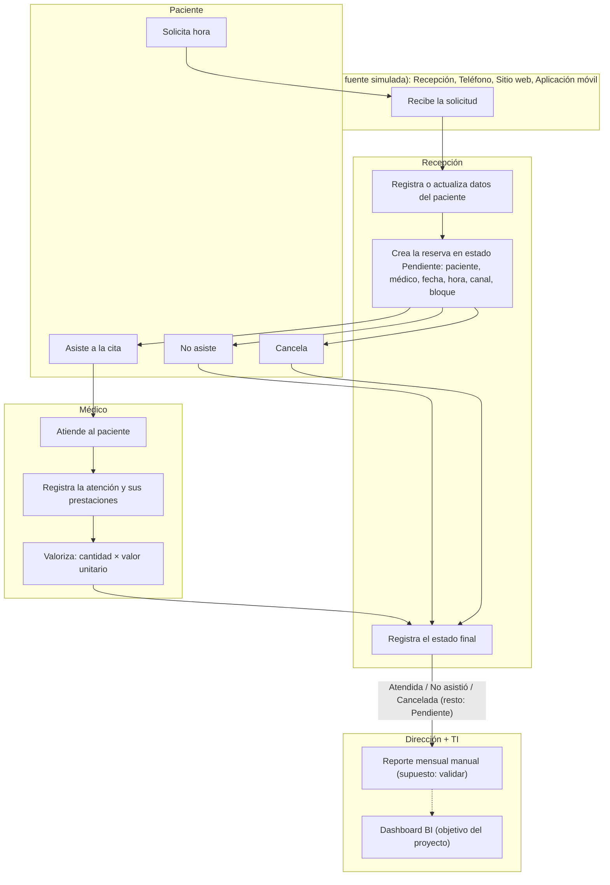
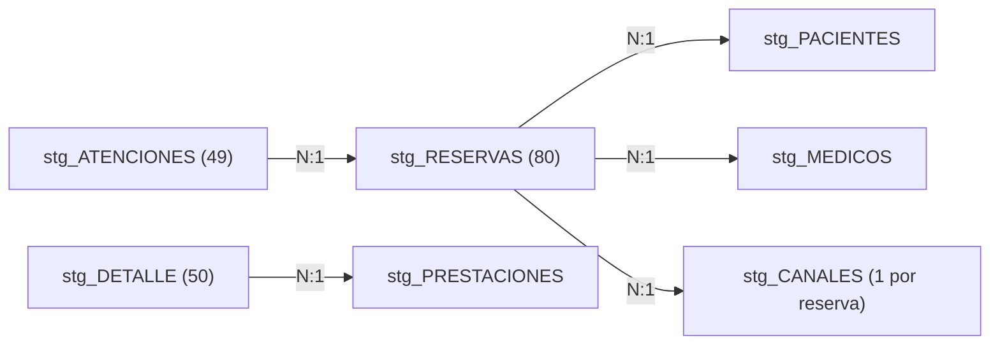
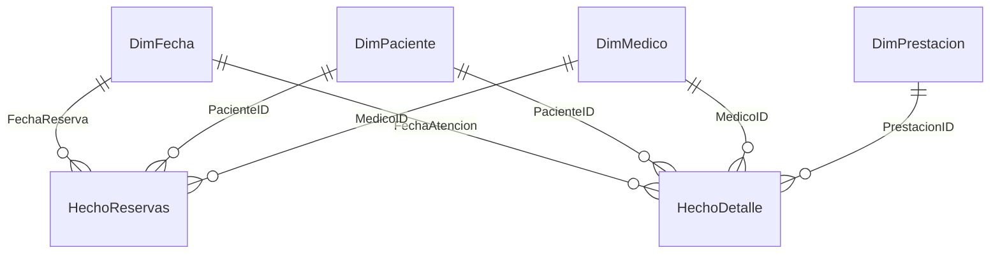

# Actividad 1 — Entender SaludVital

## 1. Contexto del proceso

SaludVital es un centro de atención ambulatoria. El proceso va desde que el paciente solicita una hora hasta que se registra la atención y su prestación:

1. **Solicitud.** El paciente pide una hora por uno de los canales: Recepción, Teléfono, Sitio web o Aplicación móvil.
2. **Registro del paciente.** Recepción registra o actualiza sus datos (comuna, previsión, fecha de nacimiento, sexo).
3. **Reserva.** Recepción crea la reserva con paciente, médico, fecha, hora, canal y bloque en minutos. Se asume que nace en estado **Pendiente**.
4. **Resolución.** La reserva termina en uno de tres estados finales:
   - **Atendida**: el paciente asiste.
   - **No asistió**: el paciente no se presenta y el bloque queda sin uso.
   - **Cancelada**: el paciente cancela y no se genera atención.
5. **Atención.** Solo las reservas Atendidas generan una atención, que el médico registra.
6. **Prestación.** Dentro de cada atención se registran una o más prestaciones, con cantidad y valor unitario. El ingreso es **valorizado** (cantidad × valor unitario). No existe fuente de pagos.
7. **Reporte.** Dirección y TI consumen estos datos. El objetivo del proyecto es reemplazar el reporte manual por un dashboard BI.

**Granos de cada registro:**

| Registro | Una fila representa |
|---|---|
| Reserva | Una hora reservada |
| Atención | Una atención efectiva |
| Detalle | Una prestación dentro de una atención |
| Canal y bloque | Una reserva |

## 2. Mapa de proceso



## 3. Entidades

| Entidad | Rol | Tablas relacionadas |
|---|---|---|
| Dirección | Decide con indicadores de demanda, productividad e ingreso | Consume el modelo BI |
| Recepción | Agenda, cancela y registra canal y bloque | RESERVAS, A08 |
| Profesionales | Atienden y registran prestaciones | MEDICOS, ATENCIONES, DETALLE_ATENCION |
| Pacientes | Solicitan y reciben atención | PACIENTES |
| Equipo BI | Construye ETL, modelo y dashboard | Todas |

## 4. Preguntas por entidad (trazables al caso)

### Dirección
| # | Pregunta | Fuente y campos |
|---|---|---|
| D1 | ¿Cuántas reservas y atenciones hay por mes? | RESERVAS.FechaReserva, ATENCIONES.FechaAtencion |
| D2 | ¿Qué ingreso valorizado generan las atenciones por mes? | DETALLE_ATENCION (Cantidad × ValorUnitario) |
| D3 | ¿Qué especialidades generan más ingreso? | PRESTACIONES.EspecialidadID, DETALLE_ATENCION |
| D4 | ¿Cuál es la tasa de inasistencia mensual? | RESERVAS.EstadoReserva |
| D5 | ¿Cuánto cambia la demanda entre el período base y el adicional? | FechaReserva |

### Recepción
| # | Pregunta | Fuente y campos |
|---|---|---|
| R1 | ¿Qué canal concentra más reservas? | A08.CanalReserva |
| R2 | ¿Qué canal tiene más inasistencias? | A08.CanalReserva, RESERVAS.EstadoReserva |
| R3 | ¿En qué día y hora hay más demanda? | FechaReserva, HoraReserva |
| R4 | ¿Cuántas reservas quedan Pendientes o Canceladas? | EstadoReserva |
| R5 | ¿Cuántas horas se pierden por inasistencia? | A08.BloqueMinutos, estado No asistió |

### Profesionales
| # | Pregunta | Fuente y campos |
|---|---|---|
| M1 | ¿Cuántas atenciones realiza cada médico? | ATENCIONES → RESERVAS.MedicoID |
| M2 | ¿Qué tasa de atención tiene cada médico sobre sus reservas? | RESERVAS.MedicoID, EstadoReserva |
| M3 | ¿Qué prestaciones realiza más cada médico? | DETALLE_ATENCION.PrestacionID |
| M4 | ¿Cuál es el ingreso promedio por atención de cada médico? | DETALLE_ATENCION, ATENCIONES |
| M5 | ¿Qué médico tiene más inasistencias en su agenda? | RESERVAS.MedicoID, EstadoReserva |

### Pacientes
| # | Pregunta | Fuente y campos |
|---|---|---|
| P1 | ¿Cuántos pacientes distintos se atienden por mes? | RESERVAS.PacienteID (conteo distinto) |
| P2 | ¿Con qué frecuencia vuelve cada paciente? | PacienteID por reserva |
| P3 | ¿Qué comunas concentran más pacientes? | PACIENTES.Comuna |
| P4 | ¿Cómo se distribuyen las reservas por previsión? | PACIENTES.Prevision |
| P5 | ¿Qué pacientes acumulan inasistencias? (solo IDs) | PacienteID, EstadoReserva |

### Equipo BI
| # | Pregunta | Fuente y campos |
|---|---|---|
| B1 | ¿Cuántas filas se leen, aceptan y rechazan por fuente? | Todas |
| B2 | ¿Qué reglas generan más rechazos? | Bitácora de calidad |
| B3 | ¿Qué etiquetas de especialidad no se resuelven con el catálogo? | MAP_ESPECIALIDADES |
| B4 | ¿El conteo se mantiene al ejecutar el ETL dos veces? | Todas las tablas cargadas |
| B5 | ¿Existen claves huérfanas entre reservas, atenciones y detalle? | ReservaID, AtencionID, PrestacionID |

## 5. Restricciones de uso

- No se usa la edad como atributo clínico.
- No se publican nombres en capturas; se usan IDs.
- No hay datos clínicos reales; los motivos de atención son categorías operacionales.
- Los resultados son de una simulación, no de operación real.

---

## Inventario de fuentes de datos

Los períodos indicados (base: 05-ene a 03-feb de 2026, adicional: 04-feb a 31-mar de 2026) provienen del archivo LEEME del ejercicio. Son una hipótesis de simulación y no un hecho operativo sobre la periodicidad real de SaludVital.

**Excel Inventario [docs/Inventario_SaludVital_v1.0_2026-11-04.xlsx]**

---

## Perfil Raw 

**Reglas**:

- **Nulo o blanco**: celda null o texto que queda vacío tras Text.Trim.
- **Fila vacía**: fila donde todos los campos son nulos o blancos.
- **Duplicado exacto**: fila idéntica a otra en todos los campos (Table.Distinct).
- **Clave repetida**: ID no nulo que aparece más de una vez, aunque el resto de la fila difiera.

| Fuente | Filas_fisicas | Nulos_reales | Distintos | Longitud_max | Tipos_encontrados | Clave_repetida | Duplicados_exactos_tabla | Fecha_ejecucion | Campo | Filas_vacias |
| :--- | :--- | :--- | :--- | :--- | :--- | :--- | :--- | :--- | :--- | :--- |
| 01_PACIENTES | 33 | 0 | 33 | 4 | text | 0 | 0 | 04-11-2026 18:07:56 | PacienteID | 0 |
| 01_PACIENTES | 33 | 3 | 2 | 1 | text, null | | 0 | 04-11-2026 18:07:56 | Sexo | 0 |
| 01_PACIENTES | 33 | 3 | 2 | 6 | text, null | | 0 | 04-11-2026 18:07:56 | Prevision | 0 |
| 01_PACIENTES | 33 | 3 | 30 | 10 | date, null | | 0 | 04-11-2026 18:07:56 | FechaNacimiento | 0 |
| 01_PACIENTES | 33 | 3 | 30 | 19 | text, null | | 0 | 04-11-2026 18:07:56 | Nombre | 0 |
| 01_PACIENTES | 33 | 3 | 5 | 11 | text, null | | 0 | 04-11-2026 18:07:56 | Comuna | 0 |
| 01_PACIENTES | 33 | 33 | 0 | | null | | 0 | 04-11-2026 18:07:56 | Column2 | 0 |
| 02_MEDICOS | 11 | 0 | 11 | 14 | text | | 0 | 04-11-2026 18:07:56 | Column3 | 0 |
| 02_MEDICOS | 11 | 0 | 11 | 20 | text | | 0 | 04-11-2026 18:07:56 | Column2 | 0 |
| 02_MEDICOS | 11 | 0 | 11 | 8 | text | | 0 | 04-11-2026 18:07:56 | Column1 | 0 |
| 03_ESPECIALIDADES | 11 | 0 | 11 | 14 | text | | 0 | 04-11-2026 18:07:56 | Column3 | 0 |
| 03_ESPECIALIDADES | 11 | 0 | 11 | 20 | text | | 0 | 04-11-2026 18:07:56 | Column2 | 0 |
| 03_ESPECIALIDADES | 11 | 0 | 11 | 8 | text | | 0 | 04-11-2026 18:07:56 | Column1 | 0 |
| 04_PRESTACIONES | 15 | 0 | 10 | 3 | text | | 0 | 04-11-2026 18:07:56 | EspecialidadID | 0 |
| 04_PRESTACIONES | 15 | 0 | 14 | 5 | number | | 0 | 04-11-2026 18:07:56 | Valor | 0 |
| 04_PRESTACIONES | 15 | 0 | 15 | 27 | text | | 0 | 04-11-2026 18:07:56 | Prestacion | 0 |

---

## Calidad e integridad

Se registra mediante consultas avanzadas la bitacora de calidad e integridad, la cual se visualiza con una tabla con los campos de bitacora_calidad, en este orden: Fuente, Clave, Campo, Regla, ValorRaw, Motivo.

---

## Aprobar contratos - Catalogo de reglas 

Excel-CatalogoReglas [docs/Catalogo_Reglas_SaludVital_v1.0_2026-11-04]

---

## Mapeo de etiquetas

**Criterio de equivalencia evidente.** Una etiqueta se resuelve sola cuando solo cambian los espacios, la tilde o las mayúsculas, o cuando un número viene escrito como texto (por ejemplo, "47000"). Se conserva siempre la etiqueta raw junto a la canónica. Los nulos no se tocan.

| Entidad | Filas de mapeo | Resultado |
|---|---|---|
| Especialidad | 13 | 11 resueltas y 2 no resueltas (fila de MAP sin ID y E99) |
| Estado | 8 | `Confirmada` no resuelta; `[Cancelada ]` con 2 filas; `ATENDIDA` con 5 |
| Canal | 7 | `[WEB ]` (8 filas) y `Kiosco` (1 fila) no resueltas; `telefono` se resuelve a Teléfono |

**Casos no resueltos (5):** fila de MAP sin ID, E99, Confirmada, WEB y Kiosco.

**Decisiones:**

- TRAUMA se resuelve por un alias respaldado en MAP_ESPECIALIDADES.
- `Confirmada` no se interpreta y sigue en cuarentena, como se definió en la Actividad 5.
- WEB queda sin resolver porque ningún catálogo la respalda. Escenario elegido: **[A / B]**. Si fue B, aprobado por: **[nombre, fecha]**.
- Los nombres canónicos de E01 a E10 son una **propuesta por aprobar**, basada en MAP y en las prestaciones.

**Evidencia:** captura de la página con `mapeo_etiquetas` y `no_resueltos`, y los archivos `Mapeo_etiquetas_[AAAA-MM-DD].xlsx` y `No_resueltos_[AAAA-MM-DD].xlsx`.

---

## Anexar dimensiones

Cada dimensión une su hoja base con la adicional y agrega la columna `Origen`. Solo se deduplican los duplicados exactos: queda la primera ocurrencia (base antes que adicional). No se completa ningún dato.

**Reglas aplicadas en staging:**

- Se recortan espacios y el texto vacío pasa a nulo.
- Los números escritos como texto se convierten a número y se conserva el valor raw (`Valor_raw`, `FechaNacimiento_raw`).
- Los nombres de E01 a E10 salen de `map_especialidades`, porque `03_ESPECIALIDADES` de la base no trae nombres. Los de E11 y E12 salen de `A03_ESPECIALIDADES` y llevan `Es_nueva_alta = true`.

| Dimensión | Filas antes | Filas después | Descartadas | Duplicado exacto descartado |
|---|---|---|---|---|
| Pacientes | 49 | 48 | 1 | P101 |
| Médicos | 17 | 16 | 1 | M011 |
| Especialidades | 13 | 12 | 1 | E11 |
| Prestaciones | 21 | 20 | 1 | PR016 |

`Clave_unica_OK` es `true` en las 4 dimensiones.

**Evidencia:** tabla `control_dim` y captura de `stg_ESPECIALIDADES` con `Es_nueva_alta`.

---

## Combinar sin fan-out

Los hechos se anexan y se enriquecen con las dimensiones mediante `fn_unir`, una función que falla con error si la clave del lado derecho se repite. Así ninguna combinación duplica filas sin avisar. Cada fila lleva `Fila_id`, `Origen`, `Idx` y `Fuente_orden` para ordenar de forma estable.



**Control de combinaciones (`control_merge`):**

| Combinación | Antes | Después | Sin fan-out |
|---|---|---|---|
| Reservas + pacientes + médicos + canal/bloque (N:1) | 80 | 80 | true |
| Atenciones + reservas (N:1) | 49 | 49 | true |
| Detalle + prestaciones (N:1) | 50 | 50 | true |

**Control de cardinalidad (`control_cardinalidad`):**

| Lado | Tabla | Filas / claves distintas | Clave única |
|---|---|---|---|
| Dimensión | Pacientes | 48 / 48 | true |
| Dimensión | Médicos | 16 / 16 | true |
| Dimensión | Prestaciones | 20 / 20 | true |
| Hecho | Reservas | 80 / 79 | false |
| Hecho | Atenciones | 49 / 48 | false |
| Hecho | Detalle | 50 / 49 | false |
| Hecho | Canales | 52 / 50 | false |

Que los hechos den `false` es lo esperado: hay duplicados (R0113, A0101, DA0101) y R0113 aparece 3 veces en A08, una con contenido distinto. Se resuelve en la sección siguiente.

**Prueba de multiplicidad:** al reemplazar `canal1` por `stg_CANALES` en `m_reservas`, la consulta falla con "La clave derecha no es única". Es el candado de `fn_unir` funcionando.

**Evidencia:** `control_merge`, `control_cardinalidad`, diagrama N:1 y captura del error de la contraprueba.

---

## Cuarentena e idempotencia

Cada fila termina en una de tres salidas: **aceptada**, **duplicado exacto descartado** o **rechazo con origen y motivo**. La clave natural es el ID de negocio y gana la primera ocurrencia de forma determinista, lo que sostiene la idempotencia.

**Control de carga (`control_carga`):**

| Tabla | Entrada | Aceptadas | Duplicados | Rechazadas |
|---|---|---|---|---|
| Pacientes | 48 | 44 | 0 | 4 |
| Médicos | 16 | 14 | 0 | 2 |
| Prestaciones | 20 | 19 | 0 | 1 |
| Reservas | 80 | 75 | 1 | 4 |
| Atenciones | 49 | 46 | 1 | 2 |
| Detalle | 50 | 41 | 1 | 8 |
| Canales/bloques | 52 | 38 | 1 | 13 |

`Cuadra` (entrada = aceptadas + duplicados + rechazadas) y `Claves_unicas_en_aceptadas` son `true` en las 7 filas. La tabla `rechazos` tiene 34 filas y `duplicados_descartados` tiene 4.

**Rechazos principales:** R0109 (sin paciente), R0119 (médico M099), R0129 (Confirmada), 1234 (ID sin prefijo), A1999, A2000, DA1998, DA1999, DA0125 (en cascada por A1999) y 5 detalles con valor nulo.

**Prueba de idempotencia (`prueba_idempotencia`):** al simular la carga de los mismos datos dos veces (`particion_x2`), las aceptadas no cambian: Reservas 75, Atenciones 46, Detalle 41, Canales/bloques 38. `Mismo_conteo` y `Mismas_filas` son `true`. Además, dos refrescos seguidos en Power BI dan los mismos conteos en `control_carga`.

**Decisiones por aprobar (DECISIONES v1.1):**

1. Los 4 pacientes incompletos (P031 a P033 y P115) quedan en cuarentena. Ninguna reserva los usa.
2. Las 8 filas de canal `telefono` con bloque nulo se rechazan, según el contrato aprobado. Esas reservas pierden su canal. Alternativa: aceptar el canal y excluir esas filas solo de la utilización (segundo escenario).
3. Quedan 2 reservas Atendida sin atención registrada (R0146 y R0148). Hallazgo para la reconciliación de la Actividad 11.

**Evidencia:** `rechazos`, `duplicados_descartados`, `control_carga`, `prueba_idempotencia` y 2 capturas del refresco doble.

---

## Modelo dimensional

### Diseño (esquema en estrella)

| Tabla | Tipo | Grano | Clave |
|---|---|---|---|
| HechoReservas | Hecho | Una fila por reserva aceptada, con su atención, canal y bloque cuando existen | ReservaID (degenerada) |
| HechoDetalle | Hecho | Una fila por prestación dentro de una atención aceptada | DetalleID (degenerada) |
| DimFecha | Dimensión | Un día, de 2026-01-05 a 2026-03-31 | Date (natural) |
| DimPaciente | Dimensión | Un paciente aceptado | PacienteID (natural) |
| DimMedico | Dimensión | Un médico aceptado, con su especialidad | MedicoID (natural) |
| DimPrestacion | Dimensión | Una prestación aceptada, con su especialidad | PrestacionID (natural) |



### Justificación

- **Dos hechos**, porque los granos son distintos: la reserva es una hora y el detalle es una prestación. Mezclarlos infla ingresos y utilización.
- **Sin DimEspecialidad**: son 12 filas con un solo atributo, por lo que se pliega como atributo en DimMedico y DimPrestacion.
- **Sin DimEstado ni DimCanal**: son 4 valores cada uno, sin atributos propios, así que quedan como columnas del hecho.
- **Campos degenerados**: ReservaID, AtencionID, DetalleID y EstadoReserva_raw.
- **Claves naturales**: los IDs son estables; si un nombre cambia, se actualiza el atributo.
- **Privacidad**: DimPaciente no incluye nombre ni fecha de nacimiento.
- Los dos hechos no se relacionan entre sí: se cruzan a través de las dimensiones. Todas las relaciones son 1:N, de dimensión a hecho, con filtro en un solo sentido.

### Verificación

| Tabla | Filas |
|---|---|
| DimPaciente | 44 |
| DimMedico | 14 |
| DimPrestacion | 19 |
| HechoReservas | 75 |
| HechoDetalle | 41 |

Estados en HechoReservas: Atendida 48, No asistió 12, Cancelada 10, Pendiente 5. Suma de `Importe`: 1.671.000 CLP (valorizado, no cobrado).

### Diccionario semántico

| Tabla | Campo | Significado | Tipo |
|---|---|---|---|
| HechoReservas | ReservaID | Identificador de la reserva | Degenerado |
| HechoReservas | FechaReserva / HoraReserva | Fecha y hora local de Chile, sin zona | Fecha / Hora |
| HechoReservas | EstadoReserva | Atendida, No asistió, Cancelada o Pendiente (normalizado) | Atributo |
| HechoReservas | EstadoReserva_raw | Valor de origen, para trazabilidad | Degenerado |
| HechoReservas | AtencionID | Atención asociada; vacío si no hay atención registrada | Degenerado |
| HechoReservas | Canal | Canal canónico, "Sin resolver" o "No registrado" | Atributo |
| HechoReservas | BloqueMinutos | Minutos programados de la reserva | Medida base |
| HechoDetalle | DetalleID / AtencionID / ReservaID | Claves de negocio | Degenerados |
| HechoDetalle | FechaAtencion | Fecha de la atención | Fecha |
| HechoDetalle | Cantidad | Unidades de la prestación | Medida base |
| HechoDetalle | ValorUnitario | Valor en CLP por unidad | Medida base |
| HechoDetalle | Importe | Cantidad × ValorUnitario, en CLP, valorizado (no cobrado) | Calculado |
| DimPrestacion | Tarifa_maestra | Tarifa de referencia; no se suma como ingreso | Atributo |
| DimMedico / DimPrestacion | Especialidad | Nombre canónico de la especialidad | Atributo |
| DimPaciente | Comuna, Prevision, Sexo | Atributos de segmentación (sin nombre ni edad) | Atributo |
| Todas | Origen | Hoja de procedencia (Base o Adicional) | Trazabilidad |

**Limitación:** el canal solo existe desde el 2026-02-04. Las 30 reservas del período base figuran como "No registrado", y la utilización solo es calculable para las reservas con bloque.

**Evidencia:** diagrama estrella de la vista Modelo, tabla de granos, justificación y diccionario.

---

## Medidas DAX

### Calculos BI

```dax
Total Reservas = COUNTROWS ( HechoReservas )

Reservas Atendidas =
CALCULATE ( COUNTROWS ( HechoReservas ), HechoReservas[EstadoReserva] = "Atendida" )

Reservas No Asistió =
CALCULATE ( COUNTROWS ( HechoReservas ), HechoReservas[EstadoReserva] = "No asistió" )

Reservas Canceladas =
CALCULATE ( COUNTROWS ( HechoReservas ), HechoReservas[EstadoReserva] = "Cancelada" )

Reservas Pendientes =
CALCULATE ( COUNTROWS ( HechoReservas ), HechoReservas[EstadoReserva] = "Pendiente" )

Reservas Resueltas =
[Reservas Atendidas] + [Reservas No Asistió] + [Reservas Canceladas]

Atenciones Realizadas = DISTINCTCOUNTNOBLANK ( HechoReservas[AtencionID] )

Tasa de Atención = DIVIDE ( [Reservas Atendidas], [Reservas Resueltas] )

Tasa de Inasistencia =
DIVIDE ( [Reservas No Asistió], [Reservas Atendidas] + [Reservas No Asistió] )

Tasa de Cancelación = DIVIDE ( [Reservas Canceladas], [Reservas Resueltas] )

Tasa de Atención sobre Total = DIVIDE ( [Reservas Atendidas], [Total Reservas] )

Ingresos = SUM ( HechoDetalle[Importe] )

Ingreso Promedio por Atención =
DIVIDE ( [Ingresos], DISTINCTCOUNT ( HechoDetalle[AtencionID] ) )

Minutos Programados (con bloque) = SUM ( HechoReservas[BloqueMinutos] )

Minutos Atendidos (con bloque) =
CALCULATE ( SUM ( HechoReservas[BloqueMinutos] ), HechoReservas[EstadoReserva] = "Atendida" )

Horas Perdidas por Inasistencia (con bloque) =
DIVIDE (
    CALCULATE ( SUM ( HechoReservas[BloqueMinutos] ), HechoReservas[EstadoReserva] = "No asistió" ),
    60
)

Utilización (solo reservas con bloque) =
DIVIDE ( [Minutos Atendidos (con bloque)], [Minutos Programados (con bloque)] )

Reservas con Bloque =
CALCULATE (
    COUNTROWS ( HechoReservas ),
    FILTER ( HechoReservas, NOT ISBLANK ( HechoReservas[BloqueMinutos] ) )
)

Cobertura de Bloque = DIVIDE ( [Reservas con Bloque], [Total Reservas] )

Ingresos Recalculados =
SUMX ( HechoDetalle, HechoDetalle[Cantidad] * HechoDetalle[ValorUnitario] )

Diferencia Ingresos = [Ingresos] - [Ingresos Recalculados]
```

### Diseñar dashboard y reflexión

Medidas:

```dax
Pacientes Distintos = DISTINCTCOUNT ( HechoReservas[PacienteID] )

Reservas por Paciente = DIVIDE ( [Total Reservas], [Pacientes Distintos] )

Médicos Activos = DISTINCTCOUNT ( HechoReservas[MedicoID] )

Reservas Mes Anterior =
CALCULATE ( [Total Reservas], DATEADD ( DimFecha[Date], -1, MONTH ) )

Variación Mensual Reservas =
DIVIDE ( [Total Reservas] - [Reservas Mes Anterior], [Reservas Mes Anterior] )
```

Columnas calculadas en `DimPaciente`:

```dax
Reservas del Paciente = CALCULATE ( COUNTROWS ( HechoReservas ) )

Tramo Frecuencia =
SWITCH (
    TRUE (),
    DimPaciente[Reservas del Paciente] = 0, "Sin reservas",
    DimPaciente[Reservas del Paciente] = 1, "1 reserva",
    DimPaciente[Reservas del Paciente] <= 3, "2 a 3 reservas",
    "4 o más"
)
```

