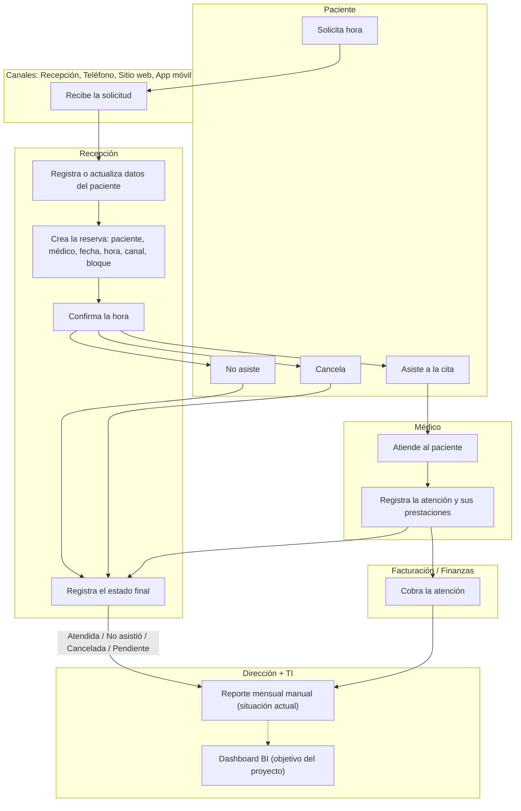

# SaludVital — Entrega ETL: Actividades 1 a 5

## Índice

1. [Actividad 1 / Entender SaludVital](#actividad-1--entender-saludvital)
   - [1.1 Contexto](#11-contexto)
   - [1.2 Proceso](#12-proceso-de-la-solicitud-de-hora-a-la-prestación)
   - [1.3 Actores](#13-actores)
   - [1.4 Preguntas por entidad](#14-preguntas-por-entidad)
   - [1.5 Límites del caso](#15-límites-del-caso)
2. [Actividad 2 / Inventariar fuentes](#actividad-2--inventariar-fuentes)
   - [2.1 Alcance](#21-alcance)
   - [2.2 Matriz de fuentes](#22-matriz-de-fuentes-de-datos)
   - [2.3 Periodicidad supuesta](#23-periodicidad-supuesta)
   - [2.4 Contrato inicial (v0.1)](#24-contrato-inicial-borrador-v01)
3. [Actividad 3 / Perfilar lo raw](#actividad-3--perfilar-lo-raw)
   - [3.1 Reglas de medición](#31-reglas-usadas-para-medir)
   - [3.2 Resumen por hoja](#32-resumen-por-hoja)
   - [3.3 Hallazgos del perfil](#33-hallazgos-del-perfil-raw)
4. [Actividad 4 / Detectar calidad e integridad](#actividad-4--detectar-calidad-e-integridad)
   - [4.1 Pruebas ejecutadas](#41-pruebas-ejecutadas)
   - [4.2 Bitácora de errores](#42-bitácora-de-errores)
   - [4.3 Valores normalizables](#43-valores-normalizables-cal15)
   - [4.4 Advertencias de coherencia](#44-advertencias-de-coherencia)
5. [Actividad 5 / Aprobar contratos](#actividad-5--aprobar-contratos)
   - [5.1 Reglas transversales](#51-reglas-transversales)
   - [5.2 Contrato por entidad](#52-contrato-por-entidad)
   - [5.3 Catálogos](#53-catálogos)
   - [5.4 Decisiones y justificación](#54-decisiones-y-justificación)

---

# Actividad 1 / Entender SaludVital

## 1.1 Contexto

SaludVital es un centro médico privado de atención **ambulatoria** en la Región del Biobío, con 8 años de operación. Partió con Medicina General, Pediatría, Ginecología y Traumatología, y hoy declara 10 especialidades, más de 20 profesionales y unas 2000 consultas mensuales.

Las horas se reservan en recepción, por teléfono, por el sitio web o por la aplicación móvil. Sus sistemas no fueron diseñados para análisis multidimensional. De ahí salen los problemas que motivan el proyecto:

- información distribuida en distintas fuentes,
- pacientes duplicados,
- especialidades con nombres inconsistentes,
- horas reservadas que no terminan en atención,
- reportes mensuales manuales,
- falta de una visión consolidada de demanda, utilización, atenciones por médico, cancelaciones, inasistencias e ingresos.

## 1.2 Proceso: de la solicitud de hora a la prestación

### Dónde nace cada dato

| Paso del proceso | Dato generado | Hoja de origen |
|---|---|---|
| Registro del paciente | Paciente | `01_PACIENTES` / `A01_PACIENTES` |
| Gestión de profesionales y especialidades | Médico, especialidad | `02_MEDICOS`, `A02_MEDICOS`, `A03_ESPECIALIDADES`, `MAP_ESPECIALIDADES` |
| Creación de la reserva y estado final | Reserva, `EstadoReserva` | `05_RESERVAS` / `A05_RESERVAS` |
| Canal y bloque horario | Canal y minutos programados | `A08_CANALES_BLOQUES` |
| Atención médica | Atención | `06_ATENCIONES` / `A06_ATENCIONES` |
| Prestaciones realizadas | Detalle de atención | `07_DETALLE_ATENCION` / `A07_DETALLE_ATENCION` |
| Catálogo de servicios y tarifas | Prestación | `04_PRESTACIONES` / `A04_PRESTACIONES` |

**Estados del proceso:** Atendida, No asistió, Cancelada y Pendiente. En las fuentes adicionales aparece también `Confirmada`, cuyo significado no está definido. No se le inventa uno y queda como pregunta abierta.

## 1.3 Actores

| Actor | Tipo | Rol en el proceso |
|---|---|---|
| Paciente | Interno | Solicita, cancela y recibe la atención |
| Médico / profesional | Interno | Otorga la atención y registra las prestaciones |
| Personal de recepción | Interno | Gestiona reservas, confirma y registra asistencia |
| Dirección / Administración | Interno | Decide y evalúa desempeño |
| Área de Sistemas / TI | Interno | Administra los sistemas de información |
| Facturación / Finanzas | Interno | Cobra y registra ingresos por atención |
| Sitio web, aplicación móvil y call center | Externo | Canales de reserva |

## 1.4 Preguntas por entidad

Las preguntas con RQ vienen de la matriz de requerimientos. Las marcadas **nueva** nacen de las fuentes adicionales. Todas son operacionales, ninguna es clínica.

| Entidad | Pregunta | RQ |
|---|---|---|
| Reserva | ¿Cuántas reservas se realizan por mes? | RQ01, RQ04 |
| | ¿Qué días de la semana concentran más demanda? | RQ03 |
| | ¿Qué porcentaje de reservas termina en atención efectiva? | RQ05 |
| | ¿Cuál es la tasa de cancelación? | RQ07 |
| | ¿Cuántas reservas están pendientes? | nueva |
| Atención | ¿Cuántas atenciones se realizan por período? | RQ21 |
| | ¿Cuántas horas se pierden por inasistencia? | RQ08 |
| | ¿Cómo evoluciona la base de pacientes atendidos? | RQ16 |
| | ¿Hay reservas Atendida sin atención registrada? | nueva |
| Detalle de atención | ¿Cuáles son los ingresos totales por período? | RQ17 |
| | ¿Cuál es el ingreso promedio por atención? | RQ19 |
| | ¿Cuántas prestaciones se registran por atención? | nueva |
| | ¿Cuántas atenciones quedan sin valorizar? | nueva |
| Paciente | ¿Qué comunas concentran más pacientes atendidos? | RQ13 |
| | ¿Qué pacientes usan con más frecuencia los servicios? | RQ14 |
| | ¿Cómo se distribuye la cartera por previsión? | RQ15 |
| | ¿Existen pacientes duplicados o incompletos? | nueva |
| Médico | ¿Qué médicos atienden más pacientes? | RQ09, RQ10 |
| | ¿Cuál es la utilización de horas por médico? | RQ11 |
| | ¿Qué médicos concentran más inasistencias? | RQ08 |
| | ¿Cuál es el ingreso promedio por médico? | RQ19 |
| Especialidad | ¿Cuál es la especialidad más solicitada? | RQ02 |
| | ¿Cuál es la tasa de inasistencia por especialidad? | RQ06 |
| | ¿Qué especialidades generan más ingresos? | RQ18 |
| | ¿Cómo se compara la tasa de atención entre especialidades? | RQ23 |
| Prestación | ¿Qué prestaciones son las más solicitadas y las más rentables? | RQ20 |
| | ¿El valor cobrado coincide con la tarifa del maestro? | nueva |
| | ¿Qué prestaciones no tienen tarifa de referencia? | nueva |
| Canal y bloque | ¿Qué canal concentra más reservas? | nueva |
| | ¿Qué canal presenta más inasistencia? | nueva |
| | ¿Qué proporción de los minutos programados se concreta? | nueva |
| | ¿Qué proporción de reservas no tiene canal informado? | nueva |

## 1.5 Límites del caso

- Los datos son **sintéticos**. El texto menciona más de 20 profesionales y unas 2000 consultas mensuales, pero las fuentes contienen volúmenes mucho menores.
- Los importes están en **CLP**, sin IVA, costos ni pagos. No existe una fuente de pagos.
- Las fechas y horas son **locales de Chile**, sin zona horaria.
- `BloqueMinutos` son **minutos programados de una reserva** y no equivalen a la capacidad total de agenda.
- La **periodicidad** de las cargas es una hipótesis del ejercicio, no un hecho operativo.
- `Diagnostico` y `Observacion` son categorías operacionales neutras y no se interpretan. La edad no se usa como atributo clínico.

---

# Actividad 2 / Inventariar fuentes

## 2.1 Alcance

- **Archivo base** `SaludVital_BaseDatos.xlsx`: 7 hojas. No se modifica.
- **Archivo adicional** `SaludVital_DatosAdicionales_ETL.xlsx`: 3 hojas de documentación y 10 hojas de datos.
- A01–A09 y `MAP_ESPECIALIDADES` son **adiciones sintéticas y deliberadamente sucias**. No contienen respuestas.
- Convención de origen en el ETL: `BASE:<hoja>` y `ADIC:<hoja>`.
- Sistema de origen: libros Excel que simulan extractos del sistema de reservas.
- Responsable: equipo BI

## 2.2 Matriz de fuentes de datos

|  | Hoja | Archivo | Período | Filas | Clave candidata | Uso |
|---|---|---|---|---|---|---|
| 1 | `01_PACIENTES` | Base | Maestro | 33 | `PacienteID` | DimPaciente |
| 2 | `02_MEDICOS` | Base | Maestro | 10 | `MedicoID` | DimMédico |
| 3 | `03_ESPECIALIDADES` | Base | Maestro | 10 | No válida (copia de `02_MEDICOS`) | Solo perfilar, se descarta |
| 4 | `04_PRESTACIONES` | Base | Maestro | 15 | `PrestacionID` | DimPrestación, origen de E01–E10 |
| 5 | `05_RESERVAS` | Base | 2026-01-05 a 2026-02-03 | 30 | `ReservaID` | Hecho de reservas |
| 6 | `06_ATENCIONES` | Base | 2026-01-05 a 2026-02-03 | 22 | `AtencionID` | Hecho de atenciones |
| 7 | `07_DETALLE_ATENCION` | Base | 2026-01-05 a 2026-02-03 | 22 | `DetalleID` | Hecho de ingresos |
| 8 | `A01_PACIENTES` | Adicional | Maestro | 16 | `PacienteID` | Anexar a `01` |
| 9 | `A02_MEDICOS` | Adicional | Maestro | 7 | `MedicoID` | Anexar a `02` |
| 10 | `A03_ESPECIALIDADES` | Adicional | Maestro | 3 | `EspecialidadID` | Altas E11/E12 |
| 11 | `A04_PRESTACIONES` | Adicional | Maestro | 6 | `PrestacionID` | Anexar a `04` |
| 12 | `A05_RESERVAS` | Adicional | 2026-02-04 a 2026-02-28 (declarado hasta 2026-03-31) | 51 (1 vacía) | `ReservaID` | Anexar a `05` |
| 13 | `A06_ATENCIONES` | Adicional | 2026-02-04 a 2026-02-24 (más filas de prueba de 2026-03-31) | 27 | `AtencionID` | Anexar a `06` |
| 14 | `A07_DETALLE_ATENCION` | Adicional | Sigue a las atenciones | 28 | `DetalleID` | Anexar a `07` |
| 15 | `A08_CANALES_BLOQUES` | Adicional | 2026-02-04 a 2026-02-28 (más una fila de 2026-03-31) | 53 (1 vacía) | `ReservaID` | Canal y utilización acotada, sin pagos |
| 16 | `MAP_ESPECIALIDADES` | Adicional | Catálogo | 13 | `EspecialidadID` + `EtiquetaFuente` | Estudio de variantes, sin mapeo automático |
| 17 | `A09_ETIQUETAS_RAW` | Adicional | Catálogo | 7 | `Entidad` + `EtiquetaRaw` | Casos a resolver: estados, canales, especialidades |

**Hojas de documentación (no son fuentes de datos):** `LEEME` (propósito, privacidad, moneda y granos), `ACTIVIDADES12` (las 12 actividades con su criterio de cierre) y `DICCIONARIO` (campos, tipos, contratos a decidir y riesgos).

## 2.3 Periodicidad supuesta

| Fuente | Hipótesis | Observado |
|---|---|---|
| Maestros base | Extracto único, sin refresco | Sin fecha |
| Transaccionales base | Carga única de 2026-01-05 a 2026-02-03 | Coincide |
| Transaccionales adicionales | Carga única simulada de 2026-02-04 a 2026-03-31 | Los datos válidos terminan el 2026-02-28 y marzo solo aparece en filas de prueba |

La periodicidad es una **hipótesis del ejercicio** y no un hecho operativo. Por eso:

- Los períodos solo ordenan el análisis y declaran la cobertura de cada fuente. No se infiere estacionalidad.
- La cobertura efectiva se verifica contra los datos y debe declararse visiblemente en el dashboard, junto con una nota de simulación y limitaciones.
- En un entorno real habría que confirmar la periodicidad con el dueño de cada sistema y diseñar cargas incrementales idempotentes.

## 2.4 Contrato inicial

Basado en `DICCIONARIO`.

| Entidad | Campos | Regla inicial |
|---|---|---|
| Paciente | `PacienteID` | Texto `P###`, único, no se completa por intuición |
| | `Nombre`, `Comuna` | Trim, conservar raw, validar vacío |
| | `FechaNacimiento` | Parsear formatos explícitos, no convertir fechas imposibles |
| | `Prevision`, `Sexo` | Catálogo documentado, sin categorías inventadas |
| Médico | `MedicoID`, `Medico`, `EspecialidadID` | ID único `M###`, la especialidad debe existir |
| Especialidad | `EspecialidadID`, `Especialidad` | Deduplicar por ID |
| Prestación | `PrestacionID`, `EspecialidadID`, `Valor` | ID único `PR###`, FK válida, parsear texto numérico, no imputar nulos, no es ingreso |
| Reserva | `ReservaID` | `R####`, sin números sin prefijo, único tras quitar exactos |
| | `FechaReserva`, `HoraReserva` | Parsear ISO, `yyyy/mm/dd` y `HH:MM`, hora local de Chile |
| | `PacienteID`, `MedicoID` | Deben existir en dimensiones limpias |
| | `EstadoReserva` | Atendida, No asistió, Cancelada, Pendiente. `Confirmada` sin catálogo va a cuarentena |
| Atención | `AtencionID`, `ReservaID`, `FechaAtencion` | ID único `A####`, reserva existente y Atendida, fecha parseable |
| | `Diagnostico`, `Observacion` | Texto neutro, fuera del modelo |
| Detalle | `DetalleID`, `AtencionID`, `PrestacionID` | ID único, eliminar exactos repetidos, FK existentes |
| | `Cantidad`, `ValorUnitario` | Cantidad > 0, parsear texto, no imputar nulos, `Importe = Cantidad × ValorUnitario` |
| Canal/bloque | `ReservaID`, `CanalReserva`, `BloqueMinutos` | Una fila por reserva, canal solo con catálogo acordado, **rechazar bloque nulo o no positivo** |
| Mapa | `EspecialidadID`, `EtiquetaFuente` | Verificar el ID contra el maestro |

**Unidades y convenciones:** moneda en CLP sin IVA, cantidad en unidades de prestación, `BloqueMinutos` en minutos programados y hora local de Chile sin zona.

---

# Actividad 3 / Perfilar lo raw

## 3.1 Reglas usadas para medir

- **Fila física:** cada fila bajo el encabezado dentro del rango usado. **Fila vacía:** todas sus celdas son `None`.
- **Nulo por campo:** celda `None`, contada solo sobre filas con datos. **Blanco:** texto vacío o solo espacios, con resultado **0 en todas las hojas**.
- **Espacios extremos:** texto distinto de su versión con `strip()`. **Valores distintos:** únicos no nulos, sensibles a mayúsculas, tildes y espacios.
- **Duplicado exacto:** fila idéntica en todas sus columnas a otra anterior. **Repetición de clave:** valor no nulo de la clave candidata que aparece más de una vez.

Una celda vacía es un nulo del campo y no una clave repetida. El `EspecialidadID` nulo de `MAP_ESPECIALIDADES` es un nulo, mientras que `E03` aparece dos veces y es una repetición de clave.

## 3.2 Resumen por hoja

| Origen | Hoja | Filas físicas | Filas vacías | Filas con datos | Columnas 100% vacías | Duplicados exactos | Repeticiones de clave |
|---|---|---|---|---|---|---|---|
| BASE | `01_PACIENTES` | 33 | 0 | 33 | 1 (col. B sin encabezado) | 0 | 0 |
| BASE | `02_MEDICOS` | 10 | 0 | 10 | 0 | 0 | 0 |
| BASE | `03_ESPECIALIDADES` | 10 | 0 | 10 | 0 | 0 | 0 |
| BASE | `04_PRESTACIONES` | 15 | 0 | 15 | 0 | 0 | 0 |
| BASE | `05_RESERVAS` | 30 | 0 | 30 | 0 | 0 | 0 |
| BASE | `06_ATENCIONES` | 22 | 0 | 22 | 0 | 0 | 0 |
| BASE | `07_DETALLE_ATENCION` | 22 | 0 | 22 | 0 | 0 | 0 |
| ADIC | `A01_PACIENTES` | 16 | 0 | 16 | 0 | 1 | 1 |
| ADIC | `A02_MEDICOS` | 7 | 0 | 7 | 0 | 1 | 1 |
| ADIC | `A03_ESPECIALIDADES` | 3 | 0 | 3 | 0 | 1 | 1 |
| ADIC | `A04_PRESTACIONES` | 6 | 0 | 6 | 0 | 1 | 1 |
| ADIC | `A05_RESERVAS` | 51 | **1** | 50 | **2** | 1 | 1 |
| ADIC | `A06_ATENCIONES` | 27 | 0 | 27 | **2** | 1 | 1 |
| ADIC | `A07_DETALLE_ATENCION` | 28 | 0 | 28 | 0 | 1 | 1 |
| ADIC | `A08_CANALES_BLOQUES` | 53 | **1** | 52 | 0 | 1 | 2 |
| ADIC | `MAP_ESPECIALIDADES` | 13 | 0 | 13 | 0 | 0 | 1 (E03, por diseño) |
| ADIC | `A09_ETIQUETAS_RAW` | 7 | 0 | 7 | 0 | 0 | sin clave |
| | **Total** | **353** | **2** | **351** | | **8** | |

**Control de cuadre:** base 142 filas físicas + adicional 211 = 353. Las filas con datos de reservas (80), atenciones (49), detalle (50) y canales (52) son el punto de partida de la conciliación de la Actividad 9.

## 3.3 Hallazgos del perfil raw

**Estructura**
- `01_PACIENTES` trae la columna B sin encabezado, 100% nula.
- `A05_RESERVAS` y `A06_ATENCIONES` traen `ColumnaVacia_Intentional` y otra columna sin encabezado, ambas 100% nulas.
- `A05_RESERVAS` y `A08_CANALES_BLOQUES` tienen una fila completamente vacía cada una, que no cuenta como nulo de campo.
- `03_ESPECIALIDADES` es idéntica a `02_MEDICOS` en campos, tipos, longitudes y distintos.

**Tipos mezclados**
- Fechas como texto: `A01.FechaNacimiento` (2), `A05.FechaReserva` (7), `A06.FechaAtencion` (6), `A08.FechaCarga` (8).
- Horas como texto: `A05.HoraReserva` (24 de 50).
- Números como texto: `A04.Valor` (1), `A07.Cantidad` (2), `A07.ValorUnitario` (5), `A08.BloqueMinutos` (8).
- IDs numéricos sin prefijo: `A05.ReservaID` (1) y `A08.ReservaID` (1).

**Nulos en datos de negocio**
- Pacientes: 3 filas sin datos en el base (P031–P033) y 1 incompleta en el adicional (P115).
- Un médico sin nombre, una prestación sin tarifa, una reserva sin `PacienteID` y una atención sin `ReservaID`.
- 5 detalles sin `ValorUnitario` y 8 canales sin `BloqueMinutos`.
- En el mapa, 1 sin `EspecialidadID` y 1 sin `EtiquetaFuente`.

**Duplicados**
- 8 duplicados exactos, uno en cada hoja adicional con clave propia (`A01` a `A08`). Ninguna hoja del base los tiene.
- `A08` repite `ReservaID` dos veces: una es duplicado exacto y la otra repite la clave con contenido distinto.

**Categorías sin normalizar**
- `A05.EstadoReserva`: 8 variantes frente a 4 estados permitidos, con 2 valores con espacios sobrantes.
- `A08.CanalReserva`: 7 variantes, con 8 valores con espacios sobrantes.
- `A09.EtiquetaRaw`: 1 valor con espacios sobrantes.

**Archivo base:** salvo `01_PACIENTES` (columna vacía y 3 filas sin datos) y `03_ESPECIALIDADES` (copia de médicos), no presenta nulos, duplicados, tipos mixtos ni blancos. Esto coincide con el perfilamiento de la Entrega 1.

---

# Actividad 4 / Detectar calidad e integridad

> Ejecución: Python + `openpyxl` sobre las fuentes raw, 16 hojas de datos.

## 4.1 Pruebas ejecutadas

| ID | Prueba | Hallazgos |
|---|---|---|
| CAL01 | Patrón de ID | 3 |
| CAL02 | ID nulo | 0 |
| CAL03 | Duplicado exacto | 8 |
| CAL04 | ID repetido con contenido distinto | 1 |
| CAL05 | Campo obligatorio nulo | 7 registros |
| CAL06 | FK inválida | 6 |
| CAL07 | Tarifa o valor unitario nulo | 6 |
| CAL08 | Estado fuera de catálogo | 1 |
| CAL09 | Fecha u hora no parseable | 0 |
| CAL10 | Cantidad no positiva | 0 |
| CAL11 | Bloque de minutos nulo o no positivo | 8 |
| CAL12 | Canal fuera de catálogo | 1 |
| CAL13 | Reserva atendida sin atención | 2 |
| CAL14 | `ValorUnitario` distinto del `Valor` del maestro | 12 de 41 líneas (advertencia) |
| CAL15 | Formato o tipo normalizable | ver 4.3 |
| CAL16 | Etiqueta de especialidad sin ID válido | 2 |

Con resultado cero: fechas y horas no parseables, cantidad no positiva, atenciones sobre reservas no atendidas y fechas de atención distintas de la reserva.

## 4.2 Bitácora de errores

| Regla | Fuente | Clave | Motivo |
|---|---|---|---|
| CAL05 | `01_PACIENTES` | P031, P032, P033 | Pacientes incompletos (5 de 5 campos nulos) |
| CAL05 | `A01_PACIENTES` | P115 | Paciente incompleto (4 de 5 nulos) |
| CAL05 | `A02_MEDICOS` | M016 | Médico sin nombre |
| CAL05 | `A05_RESERVAS` | R0109 | Reserva sin paciente |
| CAL05 | `A06_ATENCIONES` | A2000 | Atención sin reserva |
| CAL06 | `A02_MEDICOS` | M015 | `EspecialidadID` = `E99`, inexistente |
| CAL06 | `A05_RESERVAS` | R0119 | `MedicoID` = `M099`, inexistente |
| CAL06 | `A06_ATENCIONES` | A1999 | `ReservaID` = `R9999`, inexistente |
| CAL06 | `A07_DETALLE_ATENCION` | DA1998 | `AtencionID` = `A9999`, inexistente |
| CAL06 + CAL01 | `A07_DETALLE_ATENCION` | DA1999 | `PrestacionID` = `PR9999`, inexistente y con 4 dígitos |
| CAL06 + CAL12 | `A08_CANALES_BLOQUES` | R9999 | Reserva inexistente y canal `Kiosco` fuera de catálogo |
| CAL01 | `A05` y `A08` | `1234` | ID numérico sin prefijo `R` |
| CAL07 | `A04_PRESTACIONES` | PR020 | Tarifa nula, no se imputa |
| CAL07 | `A07_DETALLE_ATENCION` | DA0104, DA0109, DA0114, DA0119, DA0124 | `ValorUnitario` nulo, no se imputa |
| CAL08 | `A05_RESERVAS` | R0129 | Estado `Confirmada`, sin catálogo ni significado |
| CAL04 | `A08_CANALES_BLOQUES` | R0113 | Misma clave con otro canal y bloque (Sitio web/60 contra Recepción/30) |
| CAL11 | `A08_CANALES_BLOQUES` | R0106, R0112, R0118, R0124, R0129, R0135, R0141, R0147 | `BloqueMinutos` nulo (todas con canal `telefono`), el diccionario indica rechazar |
| CAL16 | `MAP_ESPECIALIDADES` | Sin ID y `E99` | Etiqueta sin ID e ID inexistente (`Hematología`) |
| CAL13 | `A05_RESERVAS` | R0146, R0148 | Reserva atendida sin atención registrada |

**Duplicados exactos (CAL03):** son 8 y ninguna hoja del base los tiene.

| Hoja | Clave | Fila repetida | Idéntica a la fila |
|---|---|---|---|
| `A01_PACIENTES` | P101 | 17 | 2 |
| `A02_MEDICOS` | M011 | 8 | 2 |
| `A03_ESPECIALIDADES` | E11 | 4 | 2 |
| `A04_PRESTACIONES` | PR016 | 7 | 2 |
| `A05_RESERVAS` | R0113 | 52 | 14 |
| `A06_ATENCIONES` | A0101 | 26 | 2 |
| `A07_DETALLE_ATENCION` | DA0101 | 27 | 2 |
| `A08_CANALES_BLOQUES` | R0113 | 53 | 14 |

Las filas de `A08` de las reservas R0109, R0119, R0129 y 1234 quedarán huérfanas cuando esas reservas se rechacen. No son errores raw y se tratan en las actividades 8 y 9.

## 4.3 Valores normalizables (CAL15)

Se interpretan sin rechazar y se conserva el valor raw.

- **Fechas como texto:** `A01.FechaNacimiento` (2), `A05.FechaReserva` (7), `A06.FechaAtencion` (6), `A08.FechaCarga` (8).
- **Horas como texto:** `A05.HoraReserva` (24).
- **Números como texto:** `A04.Valor` (1), `A07.Cantidad` (2), `A07.ValorUnitario` (5), `A08.BloqueMinutos` (8).
- **Estados (10):** `ATENDIDA` (5), `No Asistio` (3) y `Cancelada ` con espacio (2).
- **Canales (16):** `WEB ` (8) y `telefono` (8), que requieren catálogo aprobado.
- **Nombre con espacios sobrantes:** P101 (2 filas).

## 4.4 Advertencias de coherencia

- **CAL14:** el `ValorUnitario` difiere del `Valor` del maestro en **12 de 41** líneas aceptadas, todas en `A07`. En el base coinciden las 22. Con el valor del maestro el ingreso sería $1.684.000 en vez de $1.671.000 CLP.
- **CAL13:** R0146 y R0148 están atendidas pero no tienen atención.

---

# Actividad 5 / Aprobar contratos

## 5.1 Reglas transversales

| ID | Regla |
|---|---|
| RC-G01 | Fechas y horas son locales de Chile, sin zona horaria |
| RC-G02 | Importes en CLP, sin IVA, costos ni pagos |
| RC-G03 | Cantidad = unidades de prestación (> 0). `BloqueMinutos` = minutos programados, no capacidad total |
| RC-G04 | Cobertura: base 2026-01-05 a 2026-02-03. Adicional declarado hasta 2026-03-31, con datos válidos hasta 2026-02-28. Se declara la cobertura efectiva |
| RC-G05 | Cada fila conserva `Origen`, fila de origen y valor raw de lo normalizado |
| RC-G06 | No se imputa ni se completa un dato obligatorio. `trim` en textos y vacío = nulo |
| RC-G07 | Duplicado exacto: se descarta y se conserva la primera aparición (base antes que adicional). Clave repetida con contenido distinto: se rechaza la posterior |
| RC-G08 | `Diagnostico` y `Observacion` quedan fuera del modelo. No se publican nombres y las relaciones se prueban con IDs |

## 5.2 Contrato por entidad

Acción por defecto ante incumplimiento: **Rechazar** (cuarentena con motivo y origen). Todos los campos listados son obligatorios.

| Entidad | Campo | Tipo | Regla |
|---|---|---|---|
| Paciente | PacienteID | Texto `P###` | Único |
| | Nombre, Comuna | Texto | `trim`, conservar raw |
| | FechaNacimiento | Fecha | Parsear `yyyy/MM/dd` y `yyyy-MM-dd` |
| | Prevision, Sexo | Categoría | Catálogos observados (FONASA/Isapre, F/M), sin categorías nuevas |
| | Registro | | Si falta cualquiera de los 5 campos se rechaza |
| Médico | MedicoID | Texto `M###` | Único |
| | Medico | Texto | Nulo se rechaza |
| | EspecialidadID | FK `E##` | Debe estar en el catálogo (5.3) |
| Especialidad | EspecialidadID, Especialidad | Texto | Único. `03_ESPECIALIDADES` del base se descarta porque duplica `02_MEDICOS` |
| Prestación | PrestacionID | Texto `PR###` | Único |
| | EspecialidadID | FK | Debe estar en el catálogo |
| | Valor | Número CLP | Parsear texto, **no imputar**, es referencia y no ingreso |
| Reserva | ReservaID | Texto `R####` | Sin número sin prefijo, único tras quitar exactos |
| | FechaReserva, HoraReserva | Fecha, hora | Parsear `yyyy/MM/dd`, `yyyy-MM-dd` y `HH:MM` |
| | PacienteID, MedicoID | FK | Deben existir en dimensiones limpias |
| | EstadoReserva | Categoría | Catálogo de estados (5.3), conservar `EstadoRaw` |
| Atención | AtencionID | Texto `A####` | Único, una atención por reserva atendida |
| | ReservaID | FK | Reserva existente, aceptada y Atendida |
| | FechaAtencion | Fecha | Parsear |
| Detalle | DetalleID | Texto `DA###` o `DA####` | Único (el base usa 3 dígitos y el adicional 4) |
| | AtencionID, PrestacionID | FK | Deben existir y estar aceptadas |
| | Cantidad | Número > 0 | Parsear texto |
| | ValorUnitario | Número CLP | Parsear, **no imputar** |
| | Importe | Número CLP | Calculado: `Cantidad × ValorUnitario` sobre filas aceptadas |
| Canal/bloque | ReservaID | FK | Una fila por reserva aceptada, no se une al detalle monetario |
| | CanalReserva | Categoría | Catálogo de canales (5.3), conservar `CanalRaw` |
| | BloqueMinutos | Número > 0 | Parsear, **rechazar nulo o no positivo** |

## 5.3 Catálogos

**Estados:** Atendida (`ATENDIDA`), No asistió (`No Asistio`), Cancelada (`Cancelada `) y Pendiente. Las variantes se aceptan solo tras normalizar espacios, mayúsculas y tildes. `Confirmada` **no** está en el catálogo y no se le inventa significado.

**Canales:** Recepción, Teléfono (variante `telefono`), Sitio web (variante `WEB `) y Aplicación móvil. Las dos variantes están **propuestas, pendientes de aprobación**. `Kiosco` queda fuera.

**Especialidades:**
- E01 Medicina General, E02 Pediatría, E03 Traumatología, E04 Ginecología, E05 Cardiología, E06 Dermatología, E07 Neurología, E08 Oftalmología, E09 Endocrinología y E10 Kinesiología. Se proponen desde `MAP_ESPECIALIDADES` y las respaldan los nombres de las prestaciones.
- E11 Nutrición y E12 Rehabilitación, desde `A03_ESPECIALIDADES`.
- `E99` Hematología y la etiqueta sin ID quedan **no resueltas**.

## 5.4 Decisiones y justificación

| ID | Decisión | Justificación y efecto |
|---|---|---|
| D1 | Ingreso oficial = `Cantidad × ValorUnitario` del detalle aceptado. El `Valor` del maestro se reporta como escenario alterno | La guía indica que el `Valor` del maestro es referencia y no ingreso. **Efecto medido:** $1.671.000 contra $1.684.000 con el maestro (12 de 41 líneas difieren). Contradice RN07 del análisis original |
| D2 | `Confirmada` se rechaza | Sin catálogo ni definición. Afecta a R0129 |
| D3 | `BloqueMinutos` nulo se rechaza | Lo exige el diccionario e imputarlo falsearía la utilización. 8 filas |
| D4 | Pacientes incompletos (P031–P033, P115) se rechazan | No se completa por intuición. Ninguna reserva los referencia |
| D5 | Detalle con `ValorUnitario` nulo se rechaza | No se imputa. 5 atenciones quedan sin ingreso valorizado |
| D6 | `DetalleID` acepta 3 o 4 dígitos | El base usa `DA###` y el adicional `DA####` |
| D7 | Clave repetida con contenido distinto: se conserva la primera | En R0113 se conserva Recepción/30 y se rechaza Sitio web/60 |

---

# Actividad 6 / Resolver etiquetas 

