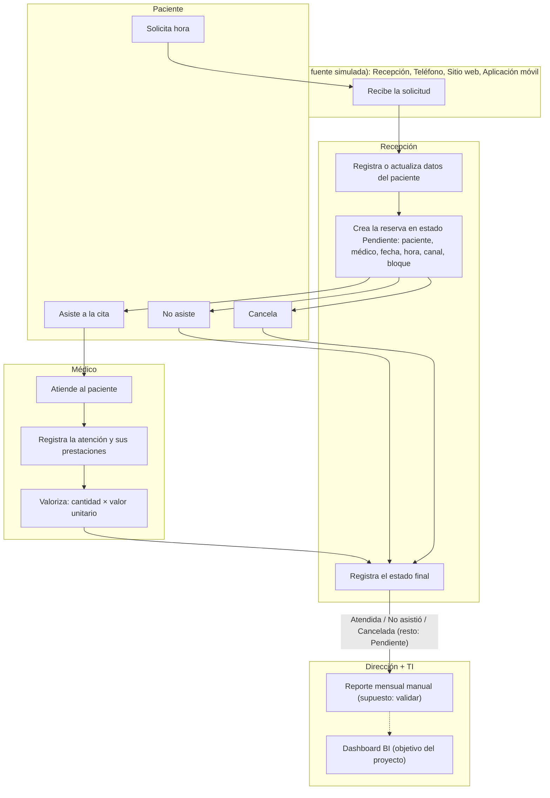

# Actividad 1 — Entender SaludVital

## 1. Contexto del proceso

SaludVital es un centro de atención ambulatoria. El proceso va desde que el paciente solicita una hora hasta que se registra la atención y su prestación:

1. **Solicitud.** El paciente pide una hora por uno de los canales: Recepción, Teléfono, Sitio web o Aplicación móvil.
2. **Registro del paciente.** Recepción registra o actualiza sus datos (comuna, previsión, fecha de nacimiento, sexo).
3. **Reserva.** Recepción crea la reserva con paciente, médico, fecha, hora, canal y bloque en minutos. Se asume que nace en estado **Pendiente**.
4. **Resolución.** La reserva termina en uno de tres estados finales:
   - **Atendida**: el paciente asiste.
   - **No asistió**: el paciente no se presenta y el bloque queda sin uso.
   - **Cancelada**: el paciente cancela y no se genera atención.
5. **Atención.** Solo las reservas Atendidas generan una atención, que el médico registra.
6. **Prestación.** Dentro de cada atención se registran una o más prestaciones, con cantidad y valor unitario. El ingreso es **valorizado** (cantidad × valor unitario). No existe fuente de pagos.
7. **Reporte.** Dirección y TI consumen estos datos. El objetivo del proyecto es reemplazar el reporte manual por un dashboard BI.

**Granos de cada registro:**

| Registro | Una fila representa |
|---|---|
| Reserva | Una hora reservada |
| Atención | Una atención efectiva |
| Detalle | Una prestación dentro de una atención |
| Canal y bloque | Una reserva |

## 2. Mapa de proceso

## 3. Entidades

| Entidad | Rol | Tablas relacionadas |
|---|---|---|
| Dirección | Decide con indicadores de demanda, productividad e ingreso | Consume el modelo BI |
| Recepción | Agenda, cancela y registra canal y bloque | RESERVAS, A08 |
| Profesionales | Atienden y registran prestaciones | MEDICOS, ATENCIONES, DETALLE_ATENCION |
| Pacientes | Solicitan y reciben atención | PACIENTES |
| Equipo BI | Construye ETL, modelo y dashboard | Todas |

## 4. Preguntas por entidad (trazables al caso)

### Dirección
| # | Pregunta | Fuente y campos |
|---|---|---|
| D1 | ¿Cuántas reservas y atenciones hay por mes? | RESERVAS.FechaReserva, ATENCIONES.FechaAtencion |
| D2 | ¿Qué ingreso valorizado generan las atenciones por mes? | DETALLE_ATENCION (Cantidad × ValorUnitario) |
| D3 | ¿Qué especialidades generan más ingreso? | PRESTACIONES.EspecialidadID, DETALLE_ATENCION |
| D4 | ¿Cuál es la tasa de inasistencia mensual? | RESERVAS.EstadoReserva |
| D5 | ¿Cuánto cambia la demanda entre el período base y el adicional? | FechaReserva |

### Recepción
| # | Pregunta | Fuente y campos |
|---|---|---|
| R1 | ¿Qué canal concentra más reservas? | A08.CanalReserva |
| R2 | ¿Qué canal tiene más inasistencias? | A08.CanalReserva, RESERVAS.EstadoReserva |
| R3 | ¿En qué día y hora hay más demanda? | FechaReserva, HoraReserva |
| R4 | ¿Cuántas reservas quedan Pendientes o Canceladas? | EstadoReserva |
| R5 | ¿Cuántas horas se pierden por inasistencia? | A08.BloqueMinutos, estado No asistió |

### Profesionales
| # | Pregunta | Fuente y campos |
|---|---|---|
| M1 | ¿Cuántas atenciones realiza cada médico? | ATENCIONES → RESERVAS.MedicoID |
| M2 | ¿Qué tasa de atención tiene cada médico sobre sus reservas? | RESERVAS.MedicoID, EstadoReserva |
| M3 | ¿Qué prestaciones realiza más cada médico? | DETALLE_ATENCION.PrestacionID |
| M4 | ¿Cuál es el ingreso promedio por atención de cada médico? | DETALLE_ATENCION, ATENCIONES |
| M5 | ¿Qué médico tiene más inasistencias en su agenda? | RESERVAS.MedicoID, EstadoReserva |

### Pacientes
| # | Pregunta | Fuente y campos |
|---|---|---|
| P1 | ¿Cuántos pacientes distintos se atienden por mes? | RESERVAS.PacienteID (conteo distinto) |
| P2 | ¿Con qué frecuencia vuelve cada paciente? | PacienteID por reserva |
| P3 | ¿Qué comunas concentran más pacientes? | PACIENTES.Comuna |
| P4 | ¿Cómo se distribuyen las reservas por previsión? | PACIENTES.Prevision |
| P5 | ¿Qué pacientes acumulan inasistencias? (solo IDs) | PacienteID, EstadoReserva |

### Equipo BI
| # | Pregunta | Fuente y campos |
|---|---|---|
| B1 | ¿Cuántas filas se leen, aceptan y rechazan por fuente? | Todas |
| B2 | ¿Qué reglas generan más rechazos? | Bitácora de calidad |
| B3 | ¿Qué etiquetas de especialidad no se resuelven con el catálogo? | MAP_ESPECIALIDADES |
| B4 | ¿El conteo se mantiene al ejecutar el ETL dos veces? | Todas las tablas cargadas |
| B5 | ¿Existen claves huérfanas entre reservas, atenciones y detalle? | ReservaID, AtencionID, PrestacionID |

## 5. Restricciones de uso

- No se usa la edad como atributo clínico.
- No se publican nombres en capturas; se usan IDs.
- No hay datos clínicos reales; los motivos de atención son categorías operacionales.
- Los resultados son de una simulación, no de operación real.

---

## Inventario de fuentes de datos

Los períodos indicados (base: 05-ene a 03-feb de 2026, adicional: 04-feb a 31-mar de 2026) provienen del archivo LEEME del ejercicio. Son una hipótesis de simulación y no un hecho operativo sobre la periodicidad real de SaludVital.

**Excel Inventario [docs/Inventario_SaludVital_v1.0_2026-11-04.xlsx]**